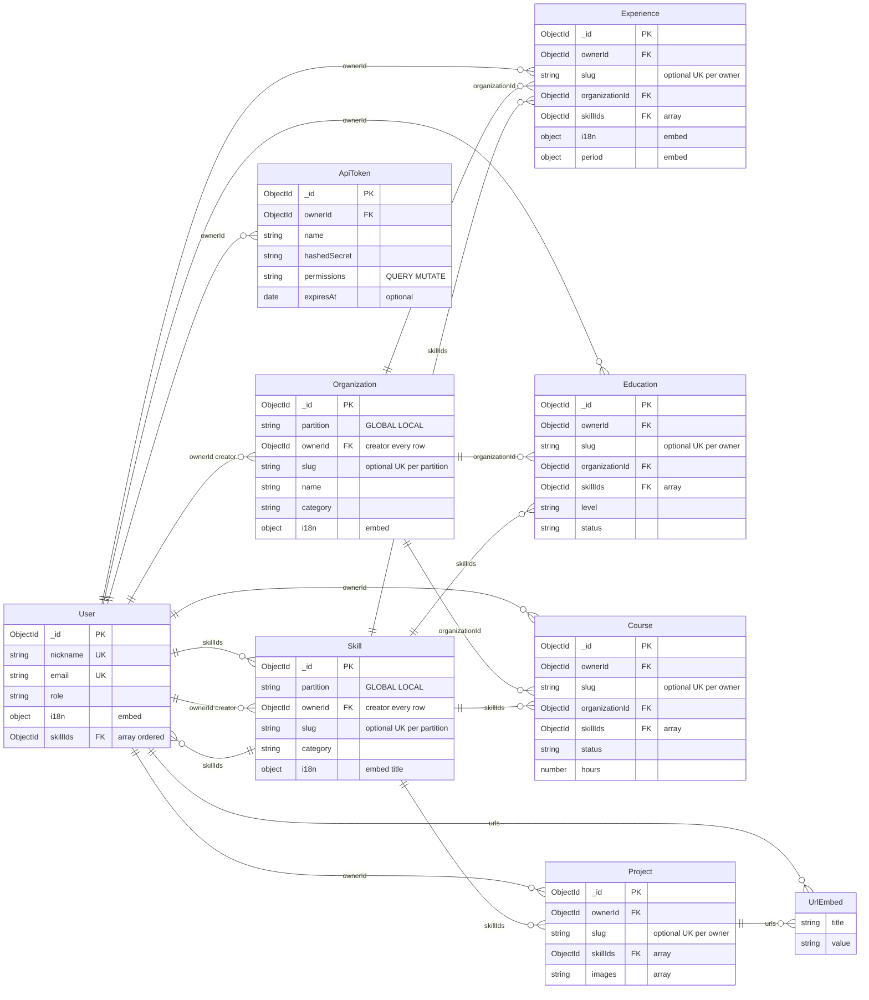

# @profile-info/api — Entity-Relationship Model

> Persistence model for the API package. Derived from `src/modules/*/schemas/*.schema.ts`
> and `src/core/schemas/*.schema.ts`.

## Overview

- **Store:** MongoDB
- **ORM / layer:** Mongoose (`@nestjs/mongoose`)
- **Top-level entities:** User, Skill, Organization, Experience, Education, Course, Project, ApiToken
- **Schema sources:** `apps/api/src/modules/*/schemas/`, `apps/api/src/core/schemas/`
- **Tenancy:** A tenant is a `User`. Private entities (`Experience`, `Education`, `Course`, `Project`) require `ownerId` → `User`. Catalog entities (`Skill`, `Organization`) use `partition` (`GLOBAL` | `LOCAL`; enum `CatalogPartition`) and always store `ownerId` → `User` (creator); `partition` drives visibility and slug uniqueness.
- **FK naming (Mongo):** every stored reference uses an explicit `*Id` / `*Ids` suffix (`ownerId`, `organizationId`, `skillIds`). GraphQL output often exposes both the FK scalar (`ownerId`, …) and the resolved relation (`owner`, `organization`, `skills`) via `@ResolveField` + DataLoaders.

## Diagram

In Mermaid `erDiagram`, attributes render only inside entity blocks (`Entity { type name }`).
Relationship lines alone do not show fields.

**Layout:** `direction LR` spreads the graph left-to-right for ultrawide screens. Entity
blocks list only key fields (PK, UK, FK, embeds); the **Entities** section below has
the full field list.

### Catalog references (`organizationId`, `skillIds`)

Both are MongoDB `ObjectId` references. The FK always lives on the document that
**owns** the pointer (Experience, Education, etc.), never on Organization or Skill.

- **Organization (`organizationId`, scalar `ObjectId`):** many-to-one. Each
  Experience/Education/Course points to at most one org.
- **Skill (`skillIds`, `ObjectId[]`):** many-to-many in practice. Each
  Experience/Education/Course/Project stores many skill ids; the same skill id appears on many
  owners.
- **Experience:** `organizationId`, `skillIds`, `i18n`, and `period` live on the root
  document (one role per experience). Grouping multiple roles at the same company is a
  read-time concern by `organizationId` (`findManyGroupedExperiences` paginates by
  organization and returns every role in each group with aggregated meta).
- **Private entities:** `ownerId` → `User` (required). Slug uniqueness is compound
  `{ ownerId, slug }`, not global.

GraphQL exposes FK scalars (`ownerId`, …) alongside resolved `owner`, `organization`,
and `skills` on output; create/update inputs use `organizationId` and `skillIds`
(no client `ownerId` on private creates — injected from context). Catalog creates also
set `ownerId` / `partition` from auth scope, not from client input.

## Entities

### User (`users`)

- **Source:** `src/modules/users/schemas/user.schema.ts`
- **Key fields:** `name`, `nickname` (unique), `email` (unique), `password` (required,
  `select: false`, not exposed in API), `role` (enum: `USER`, `SUPER_ADMIN`), `disabled`
  (default `false`; public `register` creates `disabled: true` until a `SUPER_ADMIN` sets
  `disabled: false` via `updateOneUser`), `phone`,
  `avatar`, `birth`, `address`, `i18n[]` (embed: `locale`, `messages.title`,
  `messages.description`)
- **Embedded:** `urls[]` (`UrlEmbed`: `title`, `value`), `i18n[]` translations
- **References:** `skillIds[]` → Skill (ordered; CV display priority)
- **Delete:** `SUPER_ADMIN` accounts cannot be deleted. Deleting a `USER` emits
  `user.deleted`, which hard-deletes all private entities, API tokens, and LOCAL
  catalog rows (skills/organizations) for that `ownerId`. GLOBAL catalog is untouched.

### Skill (`skills`)

- **Source:** `src/modules/skills/schemas/skill.schema.ts`
- **Key fields:** `partition` (enum: `GLOBAL`, `LOCAL`; default `GLOBAL`, indexed),
  `ownerId` (ref → User; creator, set on every row),
  `slug` (optional; unique per `{ partition, ownerId }` when set — sparse index; disabled rows still occupy the slug; re-enable to reuse),
  `category` (optional free string, indexed), `disabled`, `i18n[]` (embed: `locale`, `messages.title`)
- **Embedded:** `i18n[]` translations
- **References:** `ownerId` → User (creator); referenced by private entities via `skillIds`
- **Disable (not delete):** see ADR 001 (*Disabled entries*, *Three access intents*).

### Organization (`organizations`)

- **Source:** `src/modules/organizations/schemas/organization.schema.ts`
- **Key fields:** `partition` (enum: `GLOBAL`, `LOCAL`; default `GLOBAL`, indexed),
  `ownerId` (ref → User; creator, set on every row),
  `slug` (optional; unique per `{ partition, ownerId }` when set — sparse index; disabled rows still occupy the slug; re-enable to reuse),
  `name`, `website` (optional), `logo` (optional), `category` (enum, indexed),
  `disabled`, `i18n[]` (embed: `locale`, `messages.description`)
- **Embedded:** `i18n[]` translations
- **References:** `ownerId` → User (creator); referenced by Experience, Education, Course
- **Disable (not delete):** same as Skill — ADR 001 (*Disabled entries*, *Three access intents*).

### Experience (`experiences`)

- **Source:** `src/modules/experiences/schemas/experience.schema.ts`
- **Key fields:** `ownerId` (required, ref → User), `slug` (optional; unique per owner when set via
  sparse `{ ownerId, slug }` index), `category` (enum, indexed), `relevance`, `period`, `i18n[]`
- **Embedded:** `i18n[]` translations, `period` (`DateRange`: `from`, `to`)
- **References:** `ownerId` → User; `organizationId` → Organization (optional ObjectId);
  `skillIds[]` → Skill

### Education (`educations`)

- **Source:** `src/modules/educations/schemas/education.schema.ts`
- **Key fields:** `ownerId` (required), `slug` (optional; unique per owner when set), `level` (enum,
  indexed), `status` (enum, indexed), `url`, `image`, `relevance`, `period`, `i18n[]`
- **Embedded:** `i18n[]` translations, `period` (`DateRange`: `from`, `to`)
- **References:** `ownerId` → User; `organizationId` → Organization; `skillIds[]` → Skill

### Course (`courses`)

- **Source:** `src/modules/courses/schemas/course.schema.ts`
- **Key fields:** `ownerId` (required), `slug` (optional; unique per owner when set), `status` (enum,
  indexed), `url`, `image`, `hours`, `relevance`, `i18n[]`
- **Embedded:** `i18n[]` translations
- **References:** `ownerId` → User; `organizationId` → Organization; `skillIds[]` → Skill

### Project (`projects`)

- **Source:** `src/modules/projects/schemas/project.schema.ts`
- **Key fields:** `ownerId` (required), `slug` (optional; unique per owner when set), `relevance`,
  `images[]`, `i18n[]`
- **Embedded:** `i18n[]` translations, `urls[]` (`UrlEmbed`)
- **References:** `ownerId` → User; `skillIds[]` → Skill

### ApiToken (`api_tokens`)

- **Source:** `src/modules/api-tokens/schemas/api-token.schema.ts`
- **Key fields:** `ownerId` (required, ref → User, indexed), `name`, `hashedSecret`
  (required, `select: false`), `permissions[]` (`QUERY`, `MUTATE` — one or both),
  optional `expiresAt`; `createdAt` / `updatedAt` from `BaseModel`
- **Plaintext format:** `pi_<tokenId>_<secret>` — returned once on `createOneApiToken`
  (session JWT only); send as `X-Api-Key` on GraphQL requests; dev seed logs fixed tokens
  (see `npm run seed`)
- **References:** `ownerId` → User (GraphQL also resolves `owner` via `batchUsers`)
- **Delete:** cascade when parent `User` is deleted (`user.deleted`)

## Shared value objects

- **UrlEmbed** (`src/core/schemas/url.schema.ts`): `title`, `value`. Embedded in User and
  Project.
- **DateRange** (`src/core/schemas/daterange.schema.ts`): `from`, `to`. Embedded in
  Experience, Education, and Course.
- **Translation pattern** (`src/core/schemas/translation.schema.ts`): `locale` +
  `messages` sub-object. Embedded per entity (not a shared collection).

## Relationships summary

1. **User** owns many **Experience**, **Education**, **Course**, **Project** via required
   `ownerId`. Same slug may exist on different users (compound unique index).
2. Experience, Education, Course optionally reference **one** Organization (`organizationId`:
   scalar `ObjectId`).
3. Experience, Education, Course, Project, and User reference **many** Skills (`skillIds`:
   `ObjectId[]`). Same skill `_id` can appear on multiple owners (many-to-many). User
   `skillIds` order is CV display priority.
4. User and Project embed URL pairs; no separate `urls` collection.
5. Each Experience is one role (`i18n`, `period`, `skillIds` on the root). Multiple roles at
   the same company are separate documents sharing `organizationId`.
6. **ApiToken** belongs to one **User** via `ownerId`. CRUD requires session JWT;
   `X-Api-Key` header authenticates GraphQL (QUERY / MUTATE permissions). See
   `agents/api.md` auth and `BACKLOG.md` for token hardening.

## Delete and lifecycle notes

- **`disable*` / `enable*`** on Skill and Organization set `disabled` only — no domain
  events, no cascade. Disabled rows stay referenced until hard delete or manual ref edit.
- `skill.deleted` event: consumers `$pull` skill refs from Project, Course, Education,
  Experience, and User (`skillIds`) via `detachSkill`.
- `organization.deleted` event: hard `deleteMany` on Course, Education, Experience tied
  to that organization **across all tenants** (`purgeByOrganization`) — intentional.
- `user.deleted` event: hard `deleteMany` on Experience, Education, Course, Project,
  and ApiToken with matching `ownerId` (`purgeByOwner`); hard `deleteMany` on Skill
  and Organization with matching `ownerId` and `partition: LOCAL` (`purgeLocalByOwner`).
  **`SUPER_ADMIN` users cannot be deleted.** GLOBAL catalog rows are never purged by
  this event.
- Private entity updates never change `ownerId` — transfer ownership is delete + recreate
  if ever needed (not a product flow today).
- No Mongoose `pre('deleteOne')` hooks; deletes go through services that emit events first.

## GraphQL filter inputs

Filter `*Input` types use `PartialType(PickType(Create*Input, [...]))` — an explicit
whitelist of filterable fields. **Private (tenant-scoped) entities:** `ownerId` is not
filterable — tenant scope comes from `AuthContext`. **Catalog** (`FilterSkillInput`,
`FilterOrganizationInput`): optional `partition` and `ownerId` are filterable; read scope
still applies (see ADR 001). `FilterUserInput` excludes `password`.

## Maintaining this file

Update when adding entities, changing refs, or changing delete listeners. Keep
`agents/api.md` **Data model (ER)** section in sync (link + short summary only).
