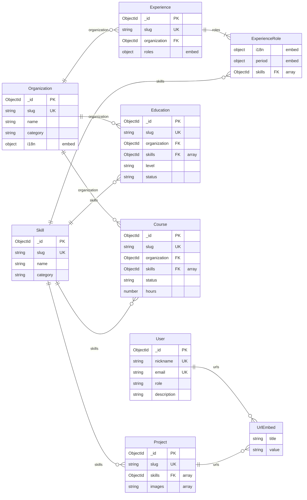

# @profile-info/api — Entity-Relationship Model

> Persistence model for the API package. Derived from `src/modules/*/schemas/*.schema.ts`
> and `src/core/schemas/*.schema.ts`.

## Overview

- **Store:** MongoDB
- **ORM / layer:** Mongoose (`@nestjs/mongoose`)
- **Top-level entities:** User, Skill, Organization, Experience, Education, Course, Project
- **Schema sources:** `apps/api/src/modules/*/schemas/`, `apps/api/src/core/schemas/`

## Diagram

In Mermaid `erDiagram`, attributes render only inside entity blocks (`Entity { type name }`).
Relationship lines alone do not show fields.

**Layout:** `direction LR` spreads the graph left-to-right for ultrawide screens. Entity
blocks list only key fields (PK, UK, FK, embeds); the **Entities** section below has
the full field list.

### Why Organization and Skill look different

Both are MongoDB `ObjectId` references. The FK always lives on the document that
**owns** the pointer (Experience, Education, etc.), never on Organization or Skill.

- **Organization (`organization`, scalar `ObjectId`):** many-to-one. Each
  Experience/Education/Course points to at most one org. Diagram:
  `Organization ||--o{ Child`. Field: `ObjectId organization FK` on the child block.
- **Skill (`skills`, `ObjectId[]`):** many-to-many in practice. Each
  Education/Course/Project/role stores many skill ids; the same skill id appears on many
  owners. Diagram: `Skill ||--o{ Owner : skills` (referenced collection on the left,
  same convention as Organization). Field: `ObjectId skills FK "array of refs"` on the
  owner block.
- **Experience:** `organization FK` is on the root document; `skills` only on embedded
  `ExperienceRole`, so the Skill edge attaches to `ExperienceRole`, not `Experience`.

The `ObjectId … FK` lines inside entity blocks are the stored refs; Mermaid edges show
which collection is pointed at.

## Entities

### User (`users`)

- **Source:** `src/modules/users/schemas/user.schema.ts`
- **Key fields:** `name`, `nickname` (unique), `email` (unique), `password` (required,
  `select: false`, not exposed in API), `role` (enum), `title`, `phone`, `avatar`,
  `birth`, `address`, `description`
- **Embedded:** `urls[]` (`UrlEmbed`: `title`, `value`)
- **References:** none

### Skill (`skills`)

- **Source:** `src/modules/skills/schemas/skill.schema.ts`
- **Key fields:** `slug` (unique), `name`, `category` (enum, indexed), `relevance`
- **Embedded:** none
- **References:** none (referenced by other entities)

### Organization (`organizations`)

- **Source:** `src/modules/organizations/schemas/organization.schema.ts`
- **Key fields:** `slug` (unique), `name`, `website`, `logo`, `category` (enum, indexed),
  `relevance`, `i18n[]` (embed: `locale`, `messages.description`)
- **Embedded:** `i18n[]` translations
- **References:** none (referenced by Experience, Education, Course)

### Experience (`experiences`)

- **Source:** `src/modules/experiences/schemas/experience.schema.ts`
- **Key fields:** `slug` (unique), `category` (enum, indexed), `relevance`
- **Embedded:** `roles[]` (`ExperienceRole`: `i18n[]`, `period`, `skills[]`)
- **References:** `organization` → Organization (optional ObjectId)

### Education (`educations`)

- **Source:** `src/modules/educations/schemas/education.schema.ts`
- **Key fields:** `slug` (unique), `level` (enum, indexed), `status` (enum, indexed),
  `url`, `image`, `relevance`, `period`, `i18n[]`
- **Embedded:** `i18n[]` translations, `period` (`DateRange`: `from`, `to`)
- **References:** `organization` → Organization; `skills[]` → Skill

### Course (`courses`)

- **Source:** `src/modules/courses/schemas/course.schema.ts`
- **Key fields:** `slug` (unique), `status` (enum, indexed), `url`, `image`, `hours`,
  `relevance`, `period`, `i18n[]`
- **Embedded:** `i18n[]` translations, `period`
- **References:** `organization` → Organization; `skills[]` → Skill

### Project (`projects`)

- **Source:** `src/modules/projects/schemas/project.schema.ts`
- **Key fields:** `slug` (unique), `relevance`, `images[]`, `i18n[]`
- **Embedded:** `i18n[]` translations, `urls[]` (`UrlEmbed`)
- **References:** `skills[]` → Skill

## Shared value objects

- **UrlEmbed** (`src/core/schemas/url.schema.ts`): `title`, `value`. Embedded in User and
  Project.
- **DateRange** (`src/core/schemas/daterange.schema.ts`): `from`, `to`. Embedded in
  Education, Course, and Experience roles.
- **Translation pattern** (`src/core/schemas/translation.schema.ts`): `locale` +
  `messages` sub-object. Embedded per entity (not a shared collection).

## Relationships summary

1. Experience, Education, Course optionally reference **one** Organization (`organization`:
   scalar `ObjectId`).
2. Education, Course, Project, and embedded Experience roles reference **many** Skills
   (`skills`: `ObjectId[]`). Same skill `_id` can appear on multiple owners (many-to-many).
3. User and Project embed URL pairs; no separate `urls` collection.
4. Experience embeds an ordered list of roles; each role embeds its own i18n, period, and
   `skills[]`.

## Delete and lifecycle notes

- `skill.deleted` event: consumers `$pull` skill refs from Project, Course, Education,
  and nested Experience role arrays (`detachSkill`).
- `organization.deleted` event: hard `deleteMany` on Course, Education, Experience tied
  to that organization (`purgeByOrganization`).
- No Mongoose `pre('deleteOne')` hooks; deletes go through services that emit events first.

## Maintaining this file

Update when adding entities, changing refs, or changing delete listeners. Keep
`agents/api.md` **Data model (ER)** section in sync (link + short summary only).
