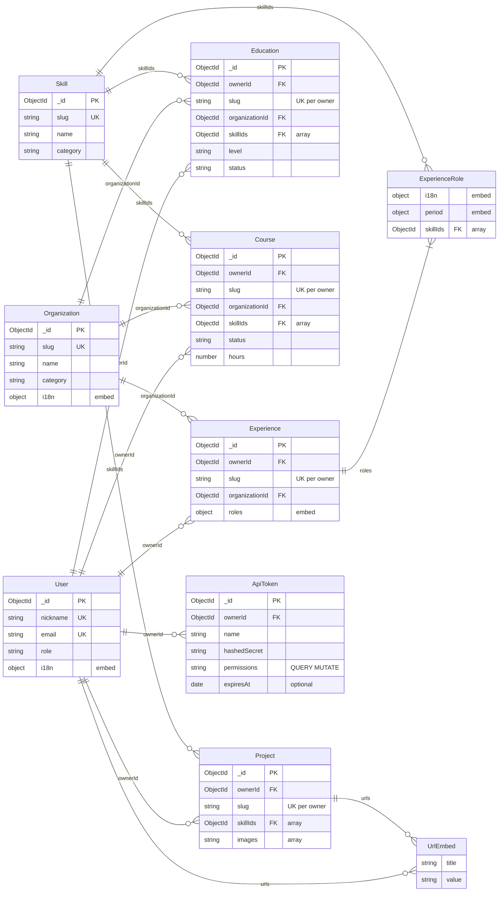

# @profile-info/api — Entity-Relationship Model

> Persistence model for the API package. Derived from `src/modules/*/schemas/*.schema.ts`
> and `src/core/schemas/*.schema.ts`.

## Overview

- **Store:** MongoDB
- **ORM / layer:** Mongoose (`@nestjs/mongoose`)
- **Top-level entities:** User, Skill, Organization, Experience, Education, Course, Project, ApiToken
- **Schema sources:** `apps/api/src/modules/*/schemas/`, `apps/api/src/core/schemas/`
- **Tenancy:** A tenant is a `User`. Private entities (`Experience`, `Education`, `Course`, `Project`) require `ownerId` → `User`. Global catalog (`Skill`, `Organization`) has no `ownerId`.
- **FK naming (Mongo):** every stored reference uses an explicit `*Id` / `*Ids` suffix (`ownerId`, `organizationId`, `skillIds`). GraphQL output resolves related entities (`owner`, `organization`, `skills`) via `@ResolveField` + DataLoaders — FK scalars are not exposed on output types.

## Diagram

In Mermaid `erDiagram`, attributes render only inside entity blocks (`Entity { type name }`).
Relationship lines alone do not show fields.

**Layout:** `direction LR` spreads the graph left-to-right for ultrawide screens. Entity
blocks list only key fields (PK, UK, FK, embeds); the **Entities** section below has
the full field list.

### Catalog references (`organizationId`, `skillIds`)

Both are MongoDB `ObjectId` references. The FK always lives on the document that
**owns** the pointer (Experience, Education, etc.), never on Organization or Skill.

- **Organization (`organizationId`, scalar `ObjectId`):** many-to-one. Each
  Experience/Education/Course points to at most one org.
- **Skill (`skillIds`, `ObjectId[]`):** many-to-many in practice. Each
  Education/Course/Project/role stores many skill ids; the same skill id appears on many
  owners.
- **Experience:** `organizationId` is on the root document; `skillIds` only on embedded
  `ExperienceRole`, so the Skill edge attaches to `ExperienceRole`, not `Experience`.
- **Private entities:** `ownerId` → `User` (required). Slug uniqueness is compound
  `{ ownerId, slug }`, not global.

GraphQL exposes resolved `owner`, `organization`, and `skills` objects on output; create/update
inputs use `organizationId` and `skillIds` (no `ownerId` — injected from context).

## Entities

### User (`users`)

- **Source:** `src/modules/users/schemas/user.schema.ts`
- **Key fields:** `name`, `nickname` (unique), `email` (unique), `password` (required,
  `select: false`, not exposed in API), `role` (enum: `USER`, `SUPER_ADMIN`), `phone`,
  `avatar`, `birth`, `address`, `i18n[]` (embed: `locale`, `messages.title`,
  `messages.description`)
- **Embedded:** `urls[]` (`UrlEmbed`: `title`, `value`), `i18n[]` translations
- **References:** none (tenant root; referenced by private entities and `ApiToken`)
- **Delete:** `SUPER_ADMIN` accounts cannot be deleted. Deleting a `USER` will cascade to
  their private entities and API tokens once `user.deleted` ships (ADR 001 phase 5d).

### Skill (`skills`)

- **Source:** `src/modules/skills/schemas/skill.schema.ts`
- **Key fields:** `slug` (unique), `name`, `category` (enum, indexed), `relevance`
- **Embedded:** none
- **References:** none (global catalog; referenced by private entities)

### Organization (`organizations`)

- **Source:** `src/modules/organizations/schemas/organization.schema.ts`
- **Key fields:** `slug` (unique), `name`, `website`, `logo`, `category` (enum, indexed),
  `relevance`, `i18n[]` (embed: `locale`, `messages.description`)
- **Embedded:** `i18n[]` translations
- **References:** none (global catalog; referenced by Experience, Education, Course)

### Experience (`experiences`)

- **Source:** `src/modules/experiences/schemas/experience.schema.ts`
- **Key fields:** `ownerId` (required, ref → User), `slug` (unique per owner via
  `{ ownerId, slug }` index), `category` (enum, indexed), `relevance`
- **Embedded:** `roles[]` (`ExperienceRole`: `i18n[]`, `period`, `skillIds[]`)
- **References:** `ownerId` → User; `organizationId` → Organization (optional ObjectId)

### Education (`educations`)

- **Source:** `src/modules/educations/schemas/education.schema.ts`
- **Key fields:** `ownerId` (required), `slug` (unique per owner), `level` (enum,
  indexed), `status` (enum, indexed), `url`, `image`, `relevance`, `period`, `i18n[]`
- **Embedded:** `i18n[]` translations, `period` (`DateRange`: `from`, `to`)
- **References:** `ownerId` → User; `organizationId` → Organization; `skillIds[]` → Skill

### Course (`courses`)

- **Source:** `src/modules/courses/schemas/course.schema.ts`
- **Key fields:** `ownerId` (required), `slug` (unique per owner), `status` (enum,
  indexed), `url`, `image`, `hours`, `relevance`, `period`, `i18n[]`
- **Embedded:** `i18n[]` translations, `period`
- **References:** `ownerId` → User; `organizationId` → Organization; `skillIds[]` → Skill

### Project (`projects`)

- **Source:** `src/modules/projects/schemas/project.schema.ts`
- **Key fields:** `ownerId` (required), `slug` (unique per owner), `relevance`,
  `images[]`, `i18n[]`
- **Embedded:** `i18n[]` translations, `urls[]` (`UrlEmbed`)
- **References:** `ownerId` → User; `skillIds[]` → Skill

### ApiToken (`api_tokens`)

- **Source:** `src/modules/api-tokens/schemas/api-token.schema.ts`
- **Key fields:** `ownerId` (required, ref → User, indexed), `name`, `hashedSecret`
  (required, `select: false`), `permissions[]` (`QUERY`, `MUTATE` — one or both),
  optional `expiresAt`; `createdAt` / `updatedAt` from `BaseModel`
- **Plaintext format:** `pi_<tokenId>_<secret>` — returned once on `createOneApiToken`
  (session JWT only); dev seed logs fixed tokens (see `npm run seed`)
- **References:** `ownerId` → User
- **Delete:** cascade when parent `User` is deleted (`user.deleted` — ADR 001 phase 5d,
  pending)

## Shared value objects

- **UrlEmbed** (`src/core/schemas/url.schema.ts`): `title`, `value`. Embedded in User and
  Project.
- **DateRange** (`src/core/schemas/daterange.schema.ts`): `from`, `to`. Embedded in
  Education, Course, and Experience roles.
- **Translation pattern** (`src/core/schemas/translation.schema.ts`): `locale` +
  `messages` sub-object. Embedded per entity (not a shared collection).

## Relationships summary

1. **User** owns many **Experience**, **Education**, **Course**, **Project** via required
   `ownerId`. Same slug may exist on different users (compound unique index).
2. Experience, Education, Course optionally reference **one** Organization (`organizationId`:
   scalar `ObjectId`).
3. Education, Course, Project, and embedded Experience roles reference **many** Skills
   (`skillIds`: `ObjectId[]`). Same skill `_id` can appear on multiple owners (many-to-many).
4. User and Project embed URL pairs; no separate `urls` collection.
5. Experience embeds an ordered list of roles; each role embeds its own i18n, period, and
   `skillIds[]`.
6. **ApiToken** belongs to one **User** via `ownerId`. CRUD requires session JWT;
   bearer `pi_…` tokens authenticate GraphQL per the [permission matrix](./adr/001-multi-tenant-migration.md#permission-matrix).

## Delete and lifecycle notes

- `skill.deleted` event: consumers `$pull` skill refs from Project, Course, Education,
  and nested Experience role arrays (`detachSkill`).
- `organization.deleted` event: hard `deleteMany` on Course, Education, Experience tied
  to that organization **across all tenants** (`purgeByOrganization`) — intentional;
  softer detach is [backlog](./adr/backlog.md).
- `user.deleted` event (ADR 001 phase 5d, pending): `deleteMany` on all private
  entities with matching `ownerId`; `deleteMany` on `ApiToken` for that `ownerId`.
  **`SUPER_ADMIN` users cannot be deleted.**
- Private entity updates never change `ownerId` — transfer is delete + recreate (see
  [backlog](./adr/backlog.md)).
- No Mongoose `pre('deleteOne')` hooks; deletes go through services that emit events first.

## GraphQL filter inputs

Filter `*Input` types use `PartialType(PickType(Create*Input, [...]))` — an explicit
whitelist of filterable fields. **`ownerId` is never filterable** (tenant scope comes
from `AuthContext`, not client filters). `FilterUserInput` excludes `password`.

## Maintaining this file

Update when adding entities, changing refs, or changing delete listeners. Keep
`agents/api.md` **Data model (ER)** section in sync (link + short summary only).
