# ADR 001: Multi-tenant core & API tokens

| Field | Value |
|-------|-------|
| **Status** | In progress |
| **Date** | 2026-06-19 (rewritten 2026-06-23) |
| **Deliverable** | One backend PR when [Definition of Done](#definition-of-done) is met |

## Where we are

**Current phase: 5b — Peripheral modules** (phase **5a** complete).

| Phase | Scope | State |
|-------|--------|-------|
| **0** | Shared foundation (`AuthContext`, `core/persistence/`, schemas) | Done |
| **1** | **Course** — reference private entity | Done |
| **2** | **Experience** — replicate Course checklist | Done |
| **3** | **Education** | Done |
| **4** | **Project** | Done |
| **5a** | Catalog & user reads (auth on `skills`, `organizations`, `users` queries) | Done |
| **5b** | Peripheral modules (`resume`, `dashboard`, `ai-tools`) | **Next** |
| **5c** | API tokens (collection, guard, CRUD, permission e2e) | Pending |
| **5d** | `user.deleted` cascade + seed tokens | Pending |

- Seed: Alice, Bob (`USER`) + Admin (`SUPER_ADMIN`); private data alternates `ownerId`.
- Admin (out of ADR scope): courses CRUD against tenant API; owner column for super admin.

**All four private entities** (Course, Experience, Education, Project) are fully migrated:
`@Auth()` on every operation, `TenantScopedCrudRepository` + `tenantStats`, no `@Public()` reads.

---

## Context

`profile-info` is evolving from a single-owner API (public reads, admin-only writes,
global data) into a multi-tenant backend: each user owns a private portfolio while
skills and organizations form a shared catalog.

**Scope: backend only.** Admin and portfolio clients follow API contract changes on
their own schedule — see [backlog](../BACKLOG.md).

### What went wrong (and stops now)

Earlier drafts split work into horizontal “lots” (persistence, then partial tenant
wiring, then remove `@Public()` later). That produced half-migrated entities:
`@Public()` queries, optional `ctx`, and `*Unscoped` service methods as temporary
escape hatches.

**That approach is abandoned.** There is no “plumbing only” phase for a private
entity. Either the entity is fully migrated, or it stays on the legacy path until
its turn.

### Hard rules

1. **No bypass paths.** Private-entity services never accept `null` context, never
   expose `*Unscoped` read methods, and never branch on “is context present?”.
2. **Auth at the resolver.** All GraphQL operations on private entities require
   authentication (session JWT for now; API tokens in phase 5). Only `signIn`,
   `GET /health`, and `GET /resume.pdf` stay public.
3. **One entity at a time.** **Course** is the reference implementation. Copy it
   verbatim for Experience → Education → Project.
4. **Foundation is shared; behavior is per-entity.** `core/persistence/`,
   `AuthContext`, and schema `ownerId` are done once. Tenant enforcement ships
   entity-by-entity with tests per entity.
5. **No data migration scripts.** Wipe and re-seed (`npm run seed`).

---

## Decision

### 1. Tenant model

**A tenant is a `User`.** No separate `Tenant` collection.

```
Platform layer   →  Skill, Organization (global catalog)
Tenant layer     →  User + Experience, Education, Course, Project (ownerId-scoped)
```

### 2. Roles

| Role | Scope |
|------|-------|
| `USER` | Own portfolio (CRUD private entities, read catalog, dashboard, AI tools, own API tokens) |
| `SUPER_ADMIN` | Global catalog mutations; read/update/delete any tenant's private data **by explicit ID** (`crossTenant`); user CRUD |

`ADMIN` was renamed to `SUPER_ADMIN`.

`SUPER_ADMIN` creates private entities under **`ctx.userId`** (same injection as
`USER`). There is no `ownerId` in GraphQL inputs and no cross-tenant create.

### 3. Private entity rules

Applies to `Experience`, `Education`, `Course`, `Project`:

| Concern | Rule |
|---------|------|
| Schema | Required `ownerId` (ref `User`); unique `{ ownerId: 1, slug: 1 }`; catalog FKs `organizationId`, `skillIds` where applicable |
| Create | `ownerId` injected from `ctx.userId`; strip if present in payload |
| Update | `ownerId` immutable — strip from payload |
| Read / delete | `USER` / API token: scoped to `ctx.userId` (404 if wrong ID). `SUPER_ADMIN`: `crossTenant: true` |
| Batch ops | Each ID tenant-scoped; partial `{ succeeded, failed }` OK |
| GraphQL reads & mutations | **No `@Public()`**; **no `@Roles(SUPER_ADMIN)`** on private CRUD (tenancy replaces role gate) |
| GraphQL output | Scalars `ownerId`, `organizationId`, `skillIds` from document; objects `owner`, `organization`, `skills` via `@ResolveField` |
| Service API | Every CRUD method: `(ctx: AuthContext, …)` — `ctx` is **required** |
| Cascades | `detachSkill`, `purgeByOrganization` use raw `CrudRepository` `updateMany` / `deleteMany` (global, no tenant filter) |

**IDOR:** wrong tenant's ID → **404**, not 403.

### 4. Persistence layer (`core/persistence/`)

Domain-agnostic; unit-tested.

#### `CrudRepository<T>`

Base Mongo access: `*OneById`, `findOne` / `findMany`, `create*`, `update*`,
`delete*`. Batch returns `BatchCount { succeeded, failed }`. Filter-based
`updateMany` / `deleteMany` are for **global cascades only**.

#### `StatsRepository<T>`

`count`, `countByField`, `findRecentlyUpdated` — global metrics for **catalog**
entities (`skills`, `organizations`). Composed as `readonly stats`.

#### `TenantScopedStatsRepository<T>`

Same API as `StatsRepository`, but every method takes `TenantScope` and applies
`withTenantScope` (or `withTenantScopeForAggregate` in `countByField` — aggregate
`$match` requires `ObjectId` `ownerId`; Mongoose casts string `ownerId` in
`find` / `countDocuments` only). Composed as `readonly tenantStats` on private-entity repos.
Service methods take `ctx: AuthContext` and delegate via `toTenantScope(ctx)`.

**Dashboard rule:** private entities → `tenantStats` (USER sees own data;
`SUPER_ADMIN` sees all via `crossTenant`). Catalog entities → global `stats`.

#### `TenantScopedCrudRepository<T>`

Composition wrapper over `CrudRepository` (does **not** extend it).

- `withTenantScope(scope, filter)` adds `ownerId: scope.userId` (string) when
  `crossTenant: false` — used by `find` / `countDocuments`.
- `withTenantScopeForAggregate(scope, filter)` adds `ownerId` as `ObjectId` — used
  only by `TenantScopedStatsRepository.countByField`.
- `createOne` / `createMany` always inject `scope.userId`; strip `ownerId` from payload (defense for internal callers — GraphQL inputs never expose `ownerId`).
- **No unscoped read helpers** — if you need unscoped access, you are in the wrong
  layer (use `CrudRepository` directly inside a cascade listener, not from a service).

```typescript
@Injectable()
export class CoursesRepository extends CrudRepository<CourseModel> {
  readonly tenantStats = new TenantScopedStatsRepository(courseModel);
  readonly tenant = new TenantScopedCrudRepository(this);
}
```

Global catalog repos extend `CrudRepository` only (+ `stats` for dashboard metrics).

#### `toTenantScope(ctx)`

```typescript
{ userId: ctx.userId, crossTenant: isSuperAdmin(ctx) }
```

### 5. Auth context

```typescript
type AuthContext =
  | { userId: string; role: UserRole; credentialKind: "session" }
  | {
      userId: string;
      role: UserRole;
      credentialKind: "api_token";
      permissions: ApiTokenPermission[];
    };
```

Helpers: `toSessionAuthContext`, `toApiTokenAuthContext`, `toTenantScope`,
`isSuperAdmin`, `isSession`, `isApiToken`, `hasPermission`.

Types and helpers exist; **API token guard and CRUD are phase 5**.

**Resolver → service:** `@Auth() ctx: AuthContext` on every
private-entity operation. The resolver does not implement ownership logic.

**Service → repository:** `repository.tenant.*(toTenantScope(ctx), …)` for all
tenant-scoped CRUD.

### 6. Filter inputs

`Filter*Input` = `PartialType(PickType(Create*Input, [whitelist]))`. Never
`PartialType(Create*Input)` wholesale. **`ownerId` is never a filter field.**

### 7. Domain events

| Event | Behavior | State |
|-------|----------|-------|
| `skill.deleted` | `$pull` `skillIds` from private entities (all tenants); nested `roles.skillIds` on Experience | Done (listeners + `detachSkill`) |
| `organization.deleted` | `deleteMany` private entities with matching `organizationId` (all tenants) | Done (`purgeByOrganization`) |
| `user.deleted` | `deleteMany` private entities + API tokens for that `ownerId`; cannot delete `SUPER_ADMIN` | **Phase 5** |

Emit before delete. Listeners stay thin.

### 8. API tokens (phase 5)

Implemented **after** all four private entities match the Course reference.

| Permission | Allows |
|------------|--------|
| `QUERY` | `getMe`, own private reads, catalog reads |
| `MUTATE` | Own private writes only |
| Combined | Union of both |

Format: `pi_` prefix, bcrypt hash in DB, plaintext once on create. Guard: `pi_` →
API token lookup; else JWT.

Token CRUD requires session JWT. See [Permission matrix](#permission-matrix).

### 9. Peripheral modules (phase 5)

| Module | Target | Current repo |
|--------|--------|--------------|
| `resume` | `buildResume(userId)`; `GET /resume.pdf?userId=` stays public | Legacy: picks first `SUPER_ADMIN` user |
| `dashboard` | Session JWT; counts scoped to `ownerId` (`SUPER_ADMIN`: platform-wide) | `@Roles(SUPER_ADMIN)` only; global counts |
| `ai-tools` | Session JWT; any authenticated user | `@Roles(SUPER_ADMIN)` only |
| `users` | Auth on reads; `SUPER_ADMIN` for user CRUD | Reads require JWT; mutations `SUPER_ADMIN` |
| `skills` / `organizations` | Auth on reads; `SUPER_ADMIN` for mutations | Reads require JWT; mutations `SUPER_ADMIN` |

---

## Migration plan

```mermaid
flowchart LR
    P0[Phase 0 Foundation]
    P1[Phase 1 Course]
    P2[Phase 2 Experience]
    P3[Phase 3 Education]
    P4[Phase 4 Project]
    P5a[Phase 5a Catalog auth]
    P5b[Phase 5b Peripheral]
    P5c[Phase 5c API tokens]
    P5d[Phase 5d User cascade]

    P0 --> P1 --> P2 --> P3 --> P4 --> P5a --> P5b --> P5c --> P5d
```



Do **not** start phase N+1 until phase N passes its [entity gate](#entity-gate).

### Phase 0 — Foundation ✅

| Item | State |
|------|-------|
| `SUPER_ADMIN` rename | Done |
| `ownerId` on private schemas + `{ ownerId, slug }` unique index | Done |
| Catalog FKs `organizationId` / `skillIds` on private schemas | Done |
| `AuthContext` + helpers (incl. API token types) | Done |
| `core/persistence/` (`CrudRepository`, `StatsRepository`, `TenantScopedCrudRepository`) | Done |
| All repos extend `CrudRepository`; services use `*OneById` / `BatchCount` | Done |
| `BatchEntity { succeeded, failed }` | Done |
| DataLoaders: `batchOrganizations`, `batchSkills`, `batchUsers` | Done |
| Seed: multi-user `ownerId` on private data | Done |

### Phase 1 — Course (reference) ✅

| Layer | State |
|-------|-------|
| `CoursesRepository.tenant` | Done |
| `CoursesService` — required `ctx`, `repository.tenant.*` | Done |
| `CoursesResolver` — no `@Public()`, `@Auth()` on all ops, `@ResolveField` for `owner` / `organization` / `skills` | Done |
| `CourseEntity` — output scalars + resolved objects | Done |
| Unit tests (`courses.service.spec.ts`, `tenant-scoped-crud.repository.spec.ts`) | Done |
| E2e isolation (`test/e2e/courses.spec.ts`) | Done |

### Phase 2 — Experience ✅

| Layer | State |
|-------|-------|
| `ExperiencesRepository.tenant` | Done |
| `ExperiencesService` — required `ctx`, `repository.tenant.*` | Done |
| `ExperiencesResolver` — no `@Public()`, no `@Roles` on private CRUD | Done |
| `@ResolveField` owner / organization / skills | Done |
| Unit tests (`experiences.service.spec.ts`) | Done |
| E2e isolation (`test/e2e/experiences.spec.ts`) | Done |

### Phase 3 — Education ✅

| Layer | State |
|-------|-------|
| Schema `ownerId` + indexes | Done (data only) |
| `EducationsRepository.tenant` | Done |
| `EducationsService` tenant CRUD | Done |
| `EducationsResolver` | Done — `@Auth()` on all ops; no `@Public()` / `@Roles` on private CRUD |
| `@ResolveField` owner / organization / skills | Done |
| Unit tests (`educations.service.spec.ts`) | Done |
| E2e isolation (`test/e2e/educations.spec.ts`) | Done |

### Phase 4 — Project ✅

| Layer | State |
|-------|-------|
| Schema `ownerId` + indexes | Done (data only) |
| `ProjectsRepository.tenant` | Done |
| `ProjectsService` tenant CRUD | Done |
| `ProjectsResolver` | Done — `@Auth()` on all ops; no `@Public()` / `@Roles` on private CRUD |
| `@ResolveField` owner / skills | Done |
| Unit tests (`projects.service.spec.ts`) | Done |
| E2e isolation (`test/e2e/projects.spec.ts`) | Done |

### Phase 5 — Cross-cutting (split)

Phase 5 is **not** one PR. It is four small phases after all private entities
migrate. Each has its own gate; do not batch unrelated concerns.

#### Phase 5a — Catalog & user reads ✅

| Item | ~scope |
|------|--------|
| Remove `@Public()` from `skills` / `organizations` / `users` **queries** | 3 resolvers |
| Keep `SUPER_ADMIN` on catalog **mutations** | unchanged |
| E2e: unauthenticated catalog read → 401 | `test/e2e/catalog.spec.ts` |

**Gate:** `npm run api:test` · smoke e2e on catalog queries.

#### Phase 5b — Peripheral modules

| Module | Work | State |
|--------|------|-------|
| `dashboard` | `@Auth() ctx`; private stats via `tenantStats`; catalog stats global; USER + SUPER_ADMIN | Done |
| `resume` | `buildResume(userId)`; keep `GET /resume.pdf?userId=` public | Pending |
| `ai-tools` | Any authenticated user (drop `@Roles(SUPER_ADMIN)`) | Pending |

**Why separate:** each module has different scoping rules; dashboard touches all
entities' `count()` / stats.

**Gate:** e2e or integration per module; manual dashboard smoke for USER vs admin.

---

### Stats scoping (implemented)

Private-entity services expose `count(ctx)`, `countByField(ctx, field)` (where
applicable), and `findRecentActivity(ctx, limit)`. Catalog services keep
unscoped `count()` / `countByField()` / `findRecentActivity()`.

#### Phase 5c — API tokens

| Item | ~scope |
|------|--------|
| `ApiToken` schema + module | new collection |
| Guard (`pi_` prefix vs JWT) | auth layer |
| Token CRUD (session only) | resolver + service |
| Permission matrix e2e | QUERY / MUTATE / combined |

**Why after 5a–5b:** tokens assume private entities and peripheral modules already
require auth; permission matrix is the largest test surface here.

**Gate:** full permission-matrix e2e green.

#### Phase 5d — User lifecycle

| Item | ~scope |
|------|--------|
| `user.deleted` event + cascade | private entities + tokens |
| Block `SUPER_ADMIN` delete | service invariant |
| Seed sample tokens | `npm run seed` |
| `ER_MODEL.md` ApiToken section | docs |

**Why last:** cascade depends on tokens existing; delete is irreversible, test last.

**Gate:** integration test user delete → no orphan private docs or tokens.

---

## Per-entity checklist (copy from Course)

Use this gate for Experience, Education, and Project.

| Layer | Done when |
|-------|-----------|
| **Repository** | `readonly tenant = new TenantScopedCrudRepository(this)` |
| **Service** | All CRUD via `repository.tenant.*`; `ctx: AuthContext` required |
| **Resolver** | No `@Public()` on queries or mutations; no `@Roles(SUPER_ADMIN)` on private CRUD; `@Auth() ctx: AuthContext` everywhere |
| **GraphQL entity** | `ownerId` + `owner`; `organizationId` + `organization` where applicable; `skillIds` + `skills` where applicable |
| **Tests** | Unit specs for scoped CRUD; e2e: 401 unauthenticated, A≠B isolation, super-admin cross-tenant read by ID |
| **Seed** | No change needed if `ownerId` already alternates users |

### Entity gate

**Automated:** `npm run lint` · `npm run api:test` · entity e2e green · `npm run seed`

**Manual (per entity):**

- [ ] Unauthenticated GraphQL query → `UNAUTHENTICATED`
- [ ] User A creates → only A lists/finds it
- [ ] User B accesses A's ID → not found
- [ ] Super admin finds A's ID by explicit ID → success
- [ ] Overlapping slugs across users on same entity type work

**Course:** all manual checks done. **Experience:** all manual checks done.
**Education:** all manual checks done. **Project:** all manual checks done.

---

## Definition of Done

Backend merge gate:

1. Phases 1–4 complete — all private entities pass the [checklist](#per-entity-checklist-copy-from-course) and entity gates.
2. GraphQL: no `@Public()` on private entities or catalog/user reads; unauthenticated private access → 401.
3. `GET /health` and `GET /resume.pdf?userId=` remain public.
4. Phases 5a–5d complete — catalog auth, peripheral modules, API tokens, user cascade.
5. `ownerId` always from `ctx.userId` on create; never from input.
6. `npm run seed` — 2 users + 1 super admin + sample tokens + isolated data.
7. `ER_MODEL.md` reflects tenancy, cascades, `ApiToken`.
8. `SUPER_ADMIN` cannot be deleted; `USER` delete cascades private data + tokens.

---

## Permission matrix

| Action | USER (session) | SUPER_ADMIN (session) | API token QUERY | API token MUTATE |
|--------|----------------|----------------------|-----------------|------------------|
| Sign in | ✓ | ✓ | — | — |
| `getMe` | ✓ | ✓ | ✓ | ✗ |
| Read own private entities | ✓ | ✓ | ✓ | ✓ |
| Read other's private entities | ✗ | ✓ | ✗ | ✗ |
| Mutate own private entities | ✓ | ✓ | ✗ | ✓ |
| Mutate other's private entities | ✗ | ✓ (by explicit ID; not create) | ✗ | ✗ |
| Read global catalog | ✓ | ✓ | ✓ | ✓ |
| Mutate global catalog | ✗ | ✓ | ✗ | ✗ |
| Dashboard / AI tools | ✓ | ✓ | ✗ | ✗ |
| Manage own API tokens | ✓ | ✓ | ✗ | ✗ |
| Manage users | ✗ | ✓ | ✗ | ✗ |

---

## Data model

### Private entities (Mongo)

```typescript
ownerId: ObjectId;           // ref User; injected from ctx.userId on create
organizationId?: ObjectId;  // ref Organization (Experience, Education, Course)
skillIds?: ObjectId[];      // ref Skill (Education, Course, Project; roles on Experience)
// unique: { ownerId: 1, slug: 1 }
```

GraphQL inputs use `organizationId` / `skillIds`; outputs also expose those scalars
plus resolved `owner`, `organization`, `skills`.

### ApiToken (phase 5)

```typescript
{
  userId: ObjectId;
  name: string;
  hashedSecret: string;
  permissions: ("QUERY" | "MUTATE")[];
  expiresAt?: Date;
  createdAt, updatedAt;
}
```

---

## Consequences

### Positive

- One obvious pattern per entity; no dual code paths.
- Security does not depend on callers “remembering” to pass `ctx`.
- First entity costs more; the next three are mechanical.

### Risks

| Risk | Mitigation |
|------|------------|
| IDOR on batch ops | `TenantScopedCrudRepository` scopes every ID |
| Admin breaks when auth lands on reads | Admin already sends JWT; regenerate codegen after schema changes |
| Large PR | Entity gates merge incrementally on feature branch; single PR at the end |
| Half-migrated entities (today) | Strict phase order; Experience must fully match Course before Education |

---

## References

- [BACKLOG](../BACKLOG.md)
- [ER_MODEL](../ER_MODEL.md)
- `agents/api.md`
