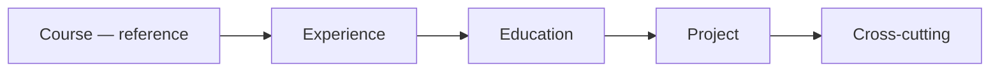

# ADR 001: Multi-tenant core & API tokens

| Field | Value |
|-------|-------|
| **Status** | In progress |
| **Date** | 2026-06-19 (rewritten 2026-06-23) |
| **Branch** | `feat/multi-tenant` |
| **Deliverable** | One backend PR when [Definition of Done](#definition-of-done) is met |

## Context

`profile-info` is evolving from a single-owner API (public reads, admin-only writes,
global data) into a multi-tenant backend: each user owns a private portfolio while
skills and organizations form a shared catalog.

**Scope: backend only.** Admin and portfolio clients follow API contract changes on
their own schedule — see [backlog](./backlog.md).

### What went wrong (and stops now)

Earlier drafts split work into horizontal “lots” (persistence, then partial tenant
wiring, then remove `@Public()` later). That produced half-migrated entities:
`@Public()` queries, optional `ctx`, and `*Unscoped` service methods as temporary
escape hatches.

**That approach is abandoned.** There is no “plumbing only” phase for a private
entity. Either the entity is fully migrated, or it stays on the legacy path until
its turn.

### Hard rules

1. **No bypass paths.** Private-entity services never accept `null` context, never
   expose `*Unscoped` read methods, and never branch on “is context present?”.
2. **Auth at the resolver.** All GraphQL operations on private entities require
   authentication (session JWT for now; API tokens in a later phase). Only `signIn`,
   `GET /health`, and `GET /resume.pdf` stay public.
3. **One entity at a time.** The first entity (**Course**) is the reference
   implementation. Copy it verbatim for Experience, Education, and Project.
4. **Foundation is shared; behavior is per-entity.** `core/persistence/`,
   `RequestContext`, and schema `ownerId` are done once. Tenant enforcement ships
   entity-by-entity with tests per entity.
5. **No data migration scripts.** Wipe and re-seed (`npm run api:seed`).

---

## Decision

### 1. Tenant model

**A tenant is a `User`.** No separate `Tenant` collection.

```
Platform layer   →  Skill, Organization (global catalog)
Tenant layer     →  User + Experience, Education, Course, Project (ownerId-scoped)
```

### 2. Roles

| Role | Scope |
|------|-------|
| `USER` | Own portfolio (CRUD private entities, read catalog, dashboard, AI tools, own API tokens) |
| `SUPER_ADMIN` | Global catalog mutations; read/update/delete any tenant's private data **by explicit ID** (`crossTenant`); user CRUD |

`ADMIN` was renamed to `SUPER_ADMIN`.

`SUPER_ADMIN` creates private entities under **`ctx.userId`** (same injection as
`USER`). There is no `ownerId` in GraphQL inputs and no cross-tenant create.

### 3. Private entity rules

Applies to `Experience`, `Education`, `Course`, `Project`:

| Concern | Rule |
|---------|------|
| Schema | Required `ownerId` (ref `User`); unique `{ ownerId: 1, slug: 1 }` |
| Create | `ownerId` injected from `ctx.userId`; strip if present in payload |
| Update | `ownerId` immutable — strip from payload |
| Read / delete | `USER` / API token: scoped to `ctx.userId` (404 if wrong ID). `SUPER_ADMIN`: `crossTenant: true` |
| Batch ops | Each ID tenant-scoped; partial `{ succeeded, failed }` OK |
| GraphQL | **No `@Public()`** on queries or mutations |
| Service API | Every CRUD method: `(ctx: RequestContext, …)` — `ctx` is **required** |
| Cascades | `detachSkill`, `purgeByOrganization` use raw `CrudRepository` `updateMany` / `deleteMany` (global, no tenant filter) |

**IDOR:** wrong tenant's ID → **404**, not 403.

### 4. Persistence layer (`core/persistence/`)

Domain-agnostic; unit-tested.

#### `CrudRepository<T>`

Base Mongo access: `*OneById`, `findOne` / `findMany`, `create*`, `update*`,
`delete*`. Batch returns `BatchCount { succeeded, failed }`. Filter-based
`updateMany` / `deleteMany` are for **global cascades only**.

#### `StatsRepository<T>`

`count`, `countByField`, `findRecentlyUpdated` — composed as `readonly stats` where
dashboard needs metrics.

#### `TenantScopedRepository<T>`

Composition wrapper over `CrudRepository` (does **not** extend it).

- `withTenantScope(scope, filter)` adds `ownerId: scope.userId` when
  `crossTenant: false`.
- `createOne` / `createMany` always inject `scope.userId`; strip `ownerId` from input.
- **No unscoped read helpers** — if you need unscoped access, you are in the wrong
  layer (use `CrudRepository` directly inside a cascade listener, not from a service).

```typescript
@Injectable()
export class CoursesRepository extends CrudRepository<CourseModel> {
  readonly stats = new StatsRepository(courseModel);
  readonly tenant = new TenantScopedRepository(this);
}
```

Global catalog repos extend `CrudRepository` only (+ `stats` if needed).

#### `toTenantScope(ctx)`

```typescript
{ userId: ctx.userId, crossTenant: isSuperAdmin(ctx) }
```

### 5. Request context

```typescript
type RequestContext =
  | { userId: string; role: UserRole; credentialKind: "session" }
  | {
      userId: string;
      role: UserRole;
      credentialKind: "api_token";
      permissions: ApiTokenPermission[];
    };
```

Helpers: `toRequestContext`, `toApiTokenRequestContext`, `toTenantScope`,
`isSuperAdmin`, `isSession`, `isApiToken`, `hasPermission`.

**Resolver → service:** `@CurrentRequestContext() ctx: RequestContext` on every
private-entity operation. The resolver does not implement ownership logic.

**Service → repository:** `repository.tenant.*(toTenantScope(ctx), …)` for all
tenant-scoped CRUD.

### 6. Filter inputs

`Filter*Input` = `PartialType(PickType(Create*Input, [whitelist]))`. Never
`PartialType(Create*Input)` wholesale. **`ownerId` is never a filter field.**

### 7. API tokens (later phase)

Implemented **after** all four private entities match the Course reference.

| Permission | Allows |
|------------|--------|
| `QUERY` | `getMe`, own private reads, catalog reads |
| `MUTATE` | Own private writes only |
| Combined | Union of both |

Format: `pi_` prefix, bcrypt hash in DB, plaintext once on create. Guard: `pi_` →
API token lookup; else JWT.

Token CRUD requires session JWT. Details unchanged from prior draft — see
[Permission matrix](#permission-matrix).

### 8. Domain events

| Event | Behavior |
|-------|----------|
| `skill.deleted` | `$pull` skill ID from all private entities (all tenants) |
| `organization.deleted` | `deleteMany` private entities referencing org (all tenants) |
| `user.deleted` | `deleteMany` private entities + API tokens for that `ownerId`; cannot delete `SUPER_ADMIN` |

Emit before delete. Listeners stay thin.

### 9. Peripheral modules (after private entities)

| Module | Change |
|--------|--------|
| `resume` | `buildResume(userId)`; `GET /resume.pdf?userId=` stays public |
| `dashboard` | Session JWT; counts scoped to `ownerId` (`SUPER_ADMIN`: platform-wide) |
| `ai-tools` | Session JWT; any authenticated user |
| `users` | Auth on reads; `SUPER_ADMIN` for user CRUD |
| `skills` / `organizations` | Auth on reads; `SUPER_ADMIN` for mutations |

---

## Reference entity: Course

**Course is the template.** When Course is “done”, the checklist below is copy-paste
for Experience → Education → Project.

### Checklist (per private entity)

| Layer | Done when |
|-------|-----------|
| **Schema** | `ownerId` + `{ ownerId, slug }` unique index |
| **Repository** | `extends CrudRepository`; `readonly tenant`; `readonly stats` if dashboard uses it |
| **Service** | All CRUD via `repository.tenant.*`; `ctx: RequestContext` on every method; payload helpers strip `ownerId`; cascades use raw repo |
| **Resolver** | No `@Public()`; `@CurrentRequestContext() ctx` on every query and mutation; no `@Roles(SUPER_ADMIN)` on private CRUD (ownership is tenant scope) |
| **Tests** | Unit specs for scoped CRUD; e2e: unauthenticated → 401; User A ≠ User B isolation; super-admin cross-tenant read by ID |
| **Seed** | `ownerId` set correctly per seed user |

### Course status

| Item | State |
|------|-------|
| Schema `ownerId` | Done |
| `CoursesRepository.tenant` | Done |
| `CoursesService` tenant CRUD | Done |
| Auth on all resolver operations (no `@Public()`, no `*Unscoped`) | Done |
| Course e2e isolation (`test/e2e/courses.spec.ts`) | Done |
| Mutations open to any authenticated user (tenant-scoped) | Done |
| Seed `ownerId` per user | Done |

**Course reference is complete.** Replicate this checklist for Experience next.

Other private entities remain **legacy** (public reads, no tenant enforcement) until
their checklist is executed.

---

## Progress

### Foundation (shared, done)

| Item | State |
|------|-------|
| `SUPER_ADMIN` rename | Done |
| `ownerId` on private schemas + compound slug index | Done |
| `RequestContext` + helpers | Done |
| `core/persistence/` (`CrudRepository`, `StatsRepository`, `TenantScopedRepository`) | Done |
| All repos extend `CrudRepository`; services use `*OneById` / `BatchCount` | Done |
| `BatchEntity { succeeded, failed }` | Done |

### Entity migration order



1. **Course** — complete ✅
2. **Experience** — replicate Course checklist
3. **Education** — replicate
4. **Project** — replicate
5. **Cross-cutting** — peripheral modules, catalog auth, API tokens, user cascade delete

Do **not** start entity N+1 until entity N passes its gate.

### Entity gate (automated)

`npm run lint` · `npm run api:test` · entity e2e green · `npm run api:seed`

### Entity gate (manual, per entity)

Course (done):

- [x] Unauthenticated GraphQL query → `UNAUTHENTICATED`
- [x] User A creates → only A lists/finds it
- [x] User B accesses A's ID → not found
- [x] Super admin finds A's ID by explicit ID → success
- [x] Overlapping slugs across users on same entity type work

Template for remaining entities:

- [ ] Unauthenticated GraphQL query → `UNAUTHENTICATED`
- [ ] User A creates → only A lists/finds it
- [ ] User B accesses A's ID → not found
- [ ] Super admin finds A's ID by explicit ID → success
- [ ] Overlapping slugs across users on same entity type work

---

## Definition of Done

Backend merge gate:

1. All four private entities pass the [reference checklist](#checklist-per-private-entity) and entity gates.
2. GraphQL: no `@Public()` except `signIn`; unauthenticated private access → 401.
3. `GET /health` and `GET /resume.pdf?userId=` remain public.
4. API tokens implemented per §7; permission matrix enforced in e2e.
5. `ownerId` always from `ctx.userId` on create; never from input.
6. `npm run api:seed` — 2 users + 1 super admin + sample tokens + isolated data.
7. `ER_MODEL.md` reflects tenancy, cascades, `ApiToken`.
8. `SUPER_ADMIN` cannot be deleted; `USER` delete cascades private data + tokens.

---

## Permission matrix

| Action | USER (session) | SUPER_ADMIN (session) | API token QUERY | API token MUTATE |
|--------|----------------|----------------------|-----------------|------------------|
| Sign in | ✓ | ✓ | — | — |
| `getMe` | ✓ | ✓ | ✓ | ✗ |
| Read own private entities | ✓ | ✓ | ✓ | ✓ |
| Read other's private entities | ✗ | ✓ | ✗ | ✗ |
| Mutate own private entities | ✓ | ✓ | ✗ | ✓ |
| Mutate other's private entities | ✗ | ✓ (by explicit ID; not create) | ✗ | ✗ |
| Read global catalog | ✓ | ✓ | ✓ | ✓ |
| Mutate global catalog | ✗ | ✓ | ✗ | ✗ |
| Dashboard / AI tools | ✓ | ✓ | ✗ | ✗ |
| Manage own API tokens | ✓ | ✓ | ✗ | ✗ |
| Manage users | ✗ | ✓ | ✗ | ✗ |

---

## Data model

### Private entities

```typescript
ownerId: ObjectId; // ref User; injected from ctx.userId on create
// unique: { ownerId: 1, slug: 1 }
```

### ApiToken (new collection, phase after entities)

```typescript
{
  userId: ObjectId;
  name: string;
  hashedSecret: string;
  permissions: ("QUERY" | "MUTATE")[];
  expiresAt?: Date;
  createdAt, updatedAt;
}
```

---

## Consequences

### Positive

- One obvious pattern per entity; no dual code paths.
- Security does not depend on callers “remembering” to pass `ctx`.
- First entity costs more; the next three are mechanical.

### Risks

| Risk | Mitigation |
|------|------------|
| IDOR on batch ops | `TenantScopedRepository` scopes every ID |
| Admin breaks when auth lands on reads | Admin already sends JWT; regenerate codegen after schema changes |
| Large PR | Entity gates merge incrementally on feature branch; single PR at the end |

---

## References

- [backlog](./backlog.md)
- `apps/api/docs/ER_MODEL.md`
- `agents/api.md`
