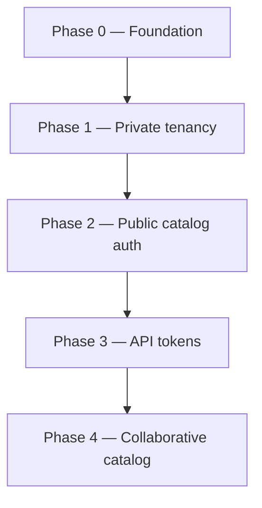

# ADR 001: Multi-tenant migration

| Field | Value |
|-------|-------|
| **Status** | Proposed |
| **Date** | 2026-06-19 |
| **Branch** | `feat/multi-tenant` |

## Context

`profile-info` today is a single-owner profile system:

- Almost all GraphQL reads are `@Public()` (no authentication).
- All mutations require `UserRole.ADMIN`.
- No entity has an `ownerId`; data is globally shared.
- `slug` is globally unique on every top-level collection.
- `ResumeService` picks the first `ADMIN` user and aggregates all data.
- Domain events (`skill.deleted`, `organization.deleted`) operate globally across
  the entire database.

The goal is to evolve into a **multi-tenant** platform where each registered user
owns a private portfolio (experiences, educations, courses, projects) while
sharing a global catalog (skills, organizations) moderated by a platform operator.

### Constraints

- **Breaking changes are acceptable** during development on `feat/multi-tenant`.
  The public portfolio client will be updated only after the full migration lands
  on `main`. No external users depend on the API yet (single production user).
- **No formal data migration scripts** for now — the sole production user will be
  backfilled manually in MongoDB.
- **Admin UI is out of scope** for early phases; validation happens via GraphQL
  sandbox and automated tests.
- **Each implementation phase ships with seeds**: 2 regular users + 1 super admin,
  each with isolated private data.

### Non-goals (for this migration)

- Team / organization accounts (B2B tenants with multiple members).
- Billing, custom domains, or per-tenant infrastructure.
- Admin-panel changes (deferred until API is stable).

---

## Decision

### 1. Tenant model

**A tenant is a `User`.** Each user owns their private entities. There is no
separate `Tenant` collection in the first iteration.

```
Platform layer     →  GlobalSkill, GlobalOrganization, moderation queue
Tenant layer       →  User + private entities + local catalog overrides
Public consumer    →  API token (QUERY scope) for portfolio sites
```

This keeps the model simple. If teams are needed later, introduce `tenantId` on
private entities without changing the global catalog design.

### 2. Role model

Replace the implicit single-admin model with explicit platform roles:

| Role | Scope |
|------|-------|
| `USER` | Own private entities; read global catalog; manage own API tokens; submit public-entity requests |
| `SUPER_ADMIN` | Full platform access: all tenants, global catalog mutations, request moderation |

The existing `ADMIN` role is **renamed to `SUPER_ADMIN`**. Seeds and guards are
updated accordingly. The current production admin user becomes the first
`SUPER_ADMIN`.

`USER` gains mutation rights on **their own private entities** (today only
`ADMIN` can mutate anything).

### 3. Entity classification

#### Private entities (tenant-scoped)

`Experience`, `Education`, `Course`, `Project`

- Add required `ownerId: ObjectId` (ref → `User`).
- Queries and mutations are scoped to `ownerId`, except `SUPER_ADMIN` bypass.
- `slug` uniqueness becomes **compound**: `{ ownerId: 1, slug: 1 }` unique.

#### Public catalog (platform-scoped)

`Skill`, `Organization`

- Remain global collections (no `ownerId` on the canonical document).
- All authenticated `USER`s can **query** the global catalog.
- Only `SUPER_ADMIN` can **mutate** the canonical catalog directly (phase 2).
- Phase 4 introduces user-submitted requests and local overrides (see below).

#### User profile

`User` is neither fully private nor catalog:

- Authenticated users can read global user listings as needed for admin flows.
- Portfolio-facing reads resolve through the API-token auth path (phase 3).
- `updateMe` remains self-service; `SUPER_ADMIN` retains full user CRUD.

### 4. Authentication model

Remove `@Public()` from entity operations. **All GraphQL operations require
authentication**, except `signIn`.

Two credential types coexist:

| Credential | Use case | Lifetime |
|------------|----------|----------|
| **Session JWT** | Admin panel login (`signIn`) | Short (current: 8h) |
| **API token** | Portfolio / public integrations | User-chosen expiry (including none) |

#### API tokens

- Stored hashed (never persist plaintext after creation).
- Belong to the creating user (tenant scope).
- Permissions (enum):
  - `QUERY` — read operations for the token owner's tenant data + global catalog
  - `MUTATE` — write operations for the token owner's private entities
- Portfolio tokens should be issued with `QUERY` only.
- Guard resolves credential → `RequestContext` with `{ userId, role, permissions }`.

`signIn` continues to return a session JWT with full user permissions (no
separate token permission flags on JWT).

### 5. Request context and authorization

Introduce a `RequestContext` (or equivalent) populated by the auth guard:

```typescript
interface RequestContext {
  userId: string;
  role: UserRole;
  permissions?: ApiTokenPermission[]; // absent for session JWT (= full access)
  isSuperAdmin: boolean;
}
```

Authorization rules:

1. **Private reads/writes** — filter by `ownerId === context.userId`, unless
   `isSuperAdmin`.
2. **Global catalog reads** — any authenticated caller; API tokens with `QUERY`.
3. **Global catalog writes** — `SUPER_ADMIN` only (direct mutations).
4. **API token writes** — require `MUTATE` permission + ownership check.
5. **IDOR prevention** — every `findOneById`, `updateOne`, `removeOne`, and
   DataLoader batch must apply tenant filters; never trust client-supplied IDs alone.

Implement filtering at the **repository/service layer**, not only in resolvers,
to prevent accidental data leaks.

### 6. Public catalog collaboration (phase 4)

Users can propose new global skills/organizations or edits to existing ones.

#### Data structures

```
GlobalSkill / GlobalOrganization     ← canonical, slug unique globally
PublicEntityRequest                ← approval queue (CREATE | UPDATE)
TenantCatalogOverride              ← per-user local version of a global entity
```

#### Request lifecycle

1. User submits a create or update request.
2. Request enters `PENDING` state.
3. `SUPER_ADMIN` reviews a list of requests grouped by target entity.
4. Admin **approves one** request or **rejects all**.

#### Local overrides

- While pending (or if rejected), the user's version is visible **only to that
  user** via `TenantCatalogOverride`.
- Private entities reference skill/org IDs the user effectively sees (override
  ID or global ID — resolved at read time: `override ?? global`).

#### Global merge with exceptions

When admin approves a global rename (e.g. `React` → `ReactJS`):

1. Update the canonical document.
2. Run a reference migration for all tenants **except** those with an active
   local override on that entity.
3. Tenants whose override matched the new canonical value drop their override
   (dedup).
4. Tenants with a different local override keep it until they accept the global
   change or admin forces resolution.

#### Conflict example

| User | Request |
|------|---------|
| A | `React` → `React` (keep) |
| B | `React` → `Angular` |
| C | `React` → `ReactJS` |

Admin approves C:

- Global `React` becomes `ReactJS`.
- All references migrate to `ReactJS` except users A and B (local overrides).
- User C's override is removed (now matches global).

### 7. Domain events

Events remain the delete-cascade mechanism. Scope changes:

| Event | Current behavior | New behavior |
|-------|------------------|--------------|
| `skill.deleted` | `$pull` from all owners | `$pull` from all owners **without** a local override on that skill; override tenants handled separately |
| `organization.deleted` | `deleteMany` on all dependent private entities | `deleteMany` only on private entities referencing the global org **and** without a local org override; super-admin action |

Emit events **before** delete (unchanged). Listeners stay thin.

### 8. Peripheral modules

| Module | Change |
|--------|--------|
| `resume` | Require auth; resolve profile from `RequestContext` (or explicit `userId` for super-admin). Remove "first ADMIN" heuristic. `GET /resume.pdf` requires API token or session JWT. |
| `dashboard` | Scope counts to `ownerId`; super-admin gets platform-wide dashboard. |
| `ai-tools` | Scope to authenticated user's private entities (or super-admin). |
| `users` | Remove public reads; portfolio access via API token. |

### 9. Seeds and testing

Each phase updates `src/seed.ts`:

- 1 × `SUPER_ADMIN` (`super@profile.info`)
- 2 × `USER` (`user-a@profile.info`, `user-b@profile.info`)
- Distinct private entities per user (overlapping slugs allowed across users).
- Shared global skills/organizations.
- At least 1 API token per user in phase 3+.

**Tenant isolation tests** are a CI gate from phase 1 onward:

- User A cannot read/update/delete user B's private entities.
- API token with `QUERY` cannot mutate.
- Non-`SUPER_ADMIN` cannot mutate global catalog.

---

## Migration phases

Work happens entirely on `feat/multi-tenant` until the full migration is complete
and the portfolio client is updated. Merge to `main` is a single coordinated
release.



### Phase 0 — Foundation

| Deliverable | Done when |
|-------------|-----------|
| This ADR accepted | Document reviewed |
| `SUPER_ADMIN` role replaces `ADMIN` | Enum, guards, seeds updated |
| `RequestContext` type + guard plumbing | Context available in resolvers/services |
| `ownerId` field on private schemas (nullable) | Schema compiles |
| Compound index `{ ownerId, slug }` on private collections | Index created |
| Seeds: 2 users + 1 super admin | `npm run api:seed` succeeds |

### Phase 1 — Private tenancy

| Deliverable | Done when |
|-------------|-----------|
| `ownerId` required on create; backfilled in prod manually | No orphan private docs |
| All private queries filter by `ownerId` | Isolation tests pass |
| `USER` can CRUD own private entities | Sandbox verified per user |
| `SUPER_ADMIN` bypass on all private data | Admin sees all tenants |
| Remove `@Public()` from private entity resolvers | Unauthenticated → 401 |
| `resume`, `dashboard`, `ai-tools` scoped to tenant | No global aggregation |
| Update `ER_MODEL.md` | Docs in sync |

### Phase 2 — Public catalog authorization

| Deliverable | Done when |
|-------------|-----------|
| Skills/organizations queries require auth | 401 without token |
| Skills/organizations mutations require `SUPER_ADMIN` | USER cannot mutate global catalog |
| Review domain event scope | Deletes don't leak across override model (prep for phase 4) |
| Seeds include shared global catalog | Both users see same skills |

### Phase 3 — API tokens

| Deliverable | Done when |
|-------------|-----------|
| `ApiToken` collection (hashed secret, permissions, expiry) | CRUD via GraphQL |
| Auth guard accepts `Authorization: Bearer <api-token>` | Token resolves to owner context |
| Permission enforcement (`QUERY` / `MUTATE`) | Tests pass |
| Remove remaining `@Public()` (except `signIn`) | All routes authenticated |
| Portfolio-ready read path documented | ADR + seed example token |

### Phase 4 — Collaborative catalog

| Deliverable | Done when |
|-------------|-----------|
| `PublicEntityRequest` model + GraphQL API | Users submit; admin lists |
| `TenantCatalogOverride` model | Local version visible only to owner |
| Admin approve/reject flow | Request lifecycle complete |
| Global merge with override exceptions | Reference migration works |
| Dedup on merge | Override removed when matching global |
| Domain events respect overrides | Delete/rename safe |
| Full seed scenario for moderation | Sandbox demo ready |

---

## Data model changes (summary)

### Private entities (Experience, Education, Course, Project)

```typescript
// Added field
ownerId: ObjectId; // ref User, required, indexed

// Index change
{ ownerId: 1, slug: 1 } // unique (replaces global slug unique)
```

### ApiToken (new collection)

```typescript
{
  userId: ObjectId;        // ref User, indexed
  name: string;            // user label, e.g. "Portfolio production"
  hashedSecret: string;
  permissions: ('QUERY' | 'MUTATE')[];
  expiresAt?: Date;       // null = no expiry
  lastUsedAt?: Date;
  createdAt, updatedAt;
}
```

### PublicEntityRequest (new collection, phase 4)

```typescript
{
  type: 'CREATE' | 'UPDATE';
  entityKind: 'SKILL' | 'ORGANIZATION';
  targetId?: ObjectId;     // set for UPDATE
  proposedPayload: object;
  submittedBy: ObjectId;   // ref User
  status: 'PENDING' | 'APPROVED' | 'REJECTED';
  reviewedBy?: ObjectId;
  reviewedAt?: Date;
}
```

### TenantCatalogOverride (new collection, phase 4)

```typescript
{
  userId: ObjectId;
  entityKind: 'SKILL' | 'ORGANIZATION';
  globalId: ObjectId;    // ref canonical entity
  overridePayload: object;
  requestId?: ObjectId;  // link to originating request
}
// unique: { userId, entityKind, globalId }
```

---

## Permission matrix

| Action | USER (session) | SUPER_ADMIN | API token QUERY | API token MUTATE |
|--------|------------------|-------------|-----------------|------------------|
| Sign in | ✓ | ✓ | — | — |
| Read own private entities | ✓ | ✓ | ✓ | ✓ |
| Read other's private entities | ✗ | ✓ | ✗ | ✗ |
| Mutate own private entities | ✓ | ✓ | ✗ | ✓ |
| Mutate other's private entities | ✗ | ✓ | ✗ | ✗ |
| Read global catalog | ✓ | ✓ | ✓ | ✓ |
| Mutate global catalog (direct) | ✗ | ✓ | ✗ | ✗ |
| Submit public-entity request | ✓ | ✓ | ✗ | ✗ |
| Moderate requests | ✗ | ✓ | ✗ | ✗ |
| Manage own API tokens | ✓ | ✓ | ✗ | ✗ |
| Manage users | ✗ | ✓ | ✗ | ✗ |

---

## Consequences

### Positive

- Clear tenant isolation boundary (`ownerId`) enables safe multi-user operation.
- API tokens decouple portfolio auth from admin sessions.
- Collaborative catalog avoids uncontrolled skill/org duplication.
- Phased delivery on a long-lived branch reduces risk of partial production state.

### Negative / risks

| Risk | Mitigation |
|------|------------|
| IDOR if filter omitted in one resolver | Repository-level enforcement + isolation test suite |
| Phase 4 complexity (overrides + merge) | Design collections in phase 0; implement last |
| Global slug conflicts on concurrent requests | Admin groups requests by target; dedup rules |
| `organization.deleted` cascade | Explicit scoping; never purge another tenant's data without ref |
| Breaking portfolio during development | Accepted; client updated before `main` merge |
| API token leakage in browser DevTools | `QUERY`-only tokens; rate limiting (future) |

### Follow-ups (post-merge)

- Rate limiting per API token.
- Token rotation and audit log.
- Admin UI for moderation queue.
- Portfolio client migration to API tokens.
- Consider `tenantId` abstraction if team accounts are needed.

---

## References

- `apps/api/docs/ER_MODEL.md` — current persistence model
- `agents/api.md` — API package context
- `apps/api/docs/CLEAN_ARCHITECTURE.md` — module layering and dependency rules
