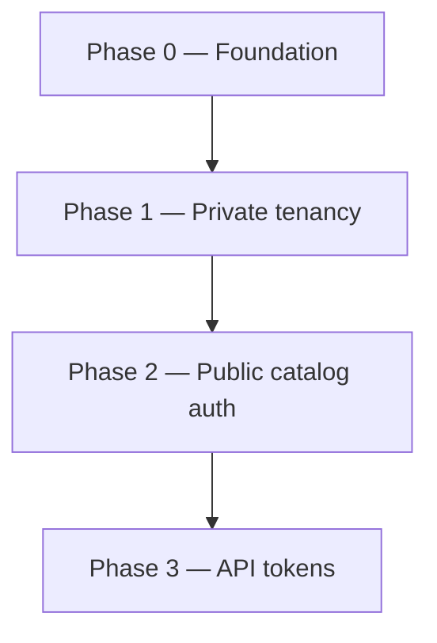

# ADR 001: Multi-tenant core & API tokens

| Field | Value |
|-------|-------|
| **Status** | Proposed |
| **Date** | 2026-06-19 |
| **Branch** | `feat/multi-tenant` |
| **Deliverable** | 1 PR — backend only; merge when Definition of Done is met |

## Context

`profile-info` today is a single-owner profile system:

- Almost all GraphQL reads are `@Public()` (no authentication).
- All mutations require `UserRole.ADMIN`.
- No entity has an `ownerId`; data is globally shared.
- `slug` is globally unique on every top-level collection.
- `ResumeService` picks the first `ADMIN` user and aggregates all data.
- Domain events (`skill.deleted`, `organization.deleted`) operate globally across
  the entire database.

The goal is to evolve the **API** into a multi-tenant backend where each user
owns a private portfolio (experiences, educations, courses, projects) while
sharing a global catalog (skills, organizations) moderated by a platform operator.

Public consumers (portfolio sites) authenticate via **API tokens** with separate
permissions (`QUERY` / `MUTATE`) so read-only integrations never need a token that
can write.

**Scope of this ADR: backend only.** Admin panel, portfolio client, and test-suite
overhaul are out of scope — see [backlog](./backlog.md).

### Constraints

- **Breaking changes are acceptable** on `feat/multi-tenant`. No external users
  depend on the API yet (single production user). Production data can be wiped and
  re-seeded; **seeds must work** (`npm run api:seed`).
- **No data migration scripts** — prefer a clean database over hours debugging
  legacy state.
- **One PR for this ADR.** Implement incrementally on the feature branch (small
  steps per session); open the PR when Definition of Done is met.
- **Seeds:** 2 regular users + 1 super admin, isolated private data, shared global
  catalog, at least one `QUERY` API token per user (phase 3).

### Non-goals (this ADR)

- Admin panel or portfolio client changes.
- User self-registration (accounts created manually for now).
- Collaborative catalog (user-submitted skill/org requests).
- Team accounts, billing, custom domains.
- Formal production migration runbooks.

---

## Decision

### 1. Tenant model

**A tenant is a `User`.** Each user owns their private entities. No separate
`Tenant` collection.

```
Platform layer     →  Skill, Organization (global catalog, SUPER_ADMIN mutates)
Tenant layer       →  User + private entities (ownerId-scoped)
Public consumer    →  API token (typically QUERY) for read integrations
```

### 2. Role model

| Role | Scope |
|------|-------|
| `USER` | Own private portfolio; read global catalog; own dashboard & AI tools (session JWT); manage own API tokens (session JWT) |
| `SUPER_ADMIN` | Platform operator: global catalog mutations; read/write any tenant's private entities by explicit ID; **does not maintain a personal portfolio** |

`ADMIN` is **renamed to `SUPER_ADMIN`**. Seeds and guards updated accordingly.

`USER` gains mutation rights on **their own private entities** (today only
`ADMIN` can mutate anything).

`SUPER_ADMIN` is not a portfolio user — the operator uses a regular `USER`
account for their own profile and reserves `SUPER_ADMIN` for system-wide
management (catalog, supporting other tenants).

### 3. Entity classification

#### Private entities (tenant-scoped)

`Experience`, `Education`, `Course`, `Project`

- Required `ownerId: ObjectId` (ref → `User`).
- **`USER`:** `ownerId` injected by the service from `ctx.userId` — never from input.
- **`SUPER_ADMIN`:** on **create**, `ownerId` is **required in input** (always
  targets another user's portfolio; the operator does not create private entities
  for themselves). On read/update/delete, operates by explicit entity ID with no
  tenant filter.
- `slug` uniqueness: compound `{ ownerId: 1, slug: 1 }` unique.

#### Public catalog (platform-scoped)

`Skill`, `Organization`

- Global collections (no `ownerId` on canonical documents).
- Authenticated callers can **query**.
- Only `SUPER_ADMIN` can **mutate** directly.

#### User profile

- `getMe` works with session JWT and API token `QUERY` (returns the token
  owner's profile, including email — acceptable for portfolio use).
- `updateMe` remains self-service for session JWT only (not API tokens).
- `SUPER_ADMIN` retains full user CRUD.
- Other user listing/detail queries require session JWT (not API tokens).

### 4. Authorization pattern

Replace the blanket `@Roles(ADMIN)` on private-entity mutations with
**ownership + role** checks.

#### Resolver responsibility

The resolver is the **entry point** for auth context:

1. Obtain `RequestContext` from the auth guard (`@CurrentUser()` / dedicated
   decorator).
2. Pass `RequestContext` as the **first argument** to every service method that
   touches tenant-scoped or role-gated data.
3. Remove `@Roles(ADMIN)` from private-entity mutations and from `dashboard` /
   `ai-tools` (any authenticated user calls them).
4. Keep `@Roles(SUPER_ADMIN)` on global catalog mutations and user CRUD (or
   equivalent check in service).

The resolver does **not** duplicate per-entity ownership logic — it only forwards
context.

#### Service responsibility

Services stay unified (no separate “admin service” vs “user service”). Each method
receives `RequestContext` and derives filters:

```typescript
function tenantFilter(ctx: RequestContext): { ownerId?: ObjectId } {
  if (ctx.isSuperAdmin) return {};
  return { ownerId: ctx.userId };
}
```

| Operation | `USER` / API token | `SUPER_ADMIN` (session JWT) |
|-----------|-------------------|----------------------------|
| List / find | Merge `tenantFilter` into query | No `ownerId` filter (sees all tenants) |
| Create | `ownerId = ctx.userId` (injected) | `ownerId` from input (required; targets another user) |
| Update / delete by ID | Load with `tenantFilter` first → 404 if not owner | By explicit ID, no tenant filter |
| Batch update / delete | Each ID must pass `tenantFilter` | Unfiltered |

**IDOR rule (USER only):** guessing another tenant's ID returns **404** (not 403),
because the query includes `ownerId` and finds nothing.

#### API token permission checks

Enforced in the guard or a thin permissions layer before the resolver:

- `QUERY` — portfolio reads only: `getMe`, private-entity queries, global catalog
  queries. No `dashboard`, no `ai-tools`, no user CRUD, no token management.
- `MUTATE` — private-entity writes only (not global catalog, not token CRUD, not
  `dashboard` / `ai-tools`).
- Session JWT — full access for the user's role (no permission enum).

API tokens cannot manage other API tokens — only a logged-in user via session JWT
creates/revokes tokens (admin panel; front out of scope).

### 5. `ownerId` rules

| Caller | Create | Read / update / delete |
|--------|--------|------------------------|
| `USER` | Service sets `ownerId = ctx.userId` | `tenantFilter(ctx)` on every op (incl. batch) |
| API token | Same as `USER` (scoped to token owner) | Same as `USER` |
| `SUPER_ADMIN` | `ownerId` **required in create input** | No `ownerId` filter; operate by explicit ID |

- `USER` and API tokens: `ownerId` is **not** an accepted input field on create
  (injection only). Filter inputs must not let `USER` override tenant scope.
- `SUPER_ADMIN` may pass `ownerId` on create only; the service rejects create
  without it.

### 6. Authentication model

#### GraphQL

All GraphQL operations require authentication **except `signIn`**.

#### REST (exceptions)

| Route | Auth |
|-------|------|
| `GET /health` | Public (ops) |
| `GET /resume.pdf` | Fully public; `userId` query param selects whose resume to build. Anyone with a valid user ID can download — acceptable for now. |

Token-based REST auth is deferred — see [backlog](./backlog.md).

#### Two credential types (GraphQL)

| Credential | Use case | Lifetime |
|------------|----------|----------|
| **Session JWT** | Admin panel (`signIn`) | Short (current: 8h) |
| **API token** | Portfolio / integrations | User-chosen expiry (including none) |

#### API token format and guard resolution

Industry-standard pattern for JWT + opaque API tokens sharing `Authorization: Bearer`:

1. **Prefix:** secrets start with `pi_` (profile-info). Example:
   `pi_a1b2c3d4e5f6…` (prefix + 32 random bytes as base64url).
2. **Storage:** persist only a **bcrypt hash** of the full secret; plaintext
   returned **once** on create (GraphQL field on the create mutation response).
3. **Guard resolution order:**
   - Extract Bearer token.
   - If token starts with `pi_` → look up by hash, build `RequestContext` with
     `permissions` from the stored record.
   - Else → existing JWT validation (`passport-jwt`).

JWTs contain dots (`header.payload.signature`); prefixed opaque tokens are
unambiguous — no double-decode attempts.

**Deferred:** `lastUsedAt`, per-user token limits, rotation UI — see [backlog](./backlog.md).

```typescript
interface RequestContext {
  userId: string;
  role: UserRole;
  permissions?: ApiTokenPermission[]; // absent for session JWT
  isSuperAdmin: boolean;
}
```

### 7. Domain events

Global catalog deletes affect all tenants that reference the entity — intentional.

| Event | Behavior |
|-------|----------|
| `skill.deleted` | `$pull` skill ID from all private entities that reference it |
| `organization.deleted` | `deleteMany` on all private entities referencing the org |

Emit **before** delete (unchanged). Listeners stay thin.

### 8. Peripheral modules

| Module | Change |
|--------|--------|
| `resume` | `buildResume(userId)` — stop "first ADMIN" heuristic. `GET /resume.pdf?userId=&locale=` stays `@Public()`. |
| `dashboard` | Session JWT only. Pass `RequestContext`; scope counts to `ownerId`. `SUPER_ADMIN` sees platform-wide totals. |
| `ai-tools` | Session JWT only. Any `USER` or `SUPER_ADMIN` (no paid plan gate yet). |
| `users` | Remove `@Public()` from reads; `SUPER_ADMIN` for user CRUD mutations. |

### 9. Seeds and testing

Minimum CI gate from phase 1a:

- User A cannot read/update/delete User B's private entities (by ID or batch).
- API token with `QUERY` cannot mutate.
- Non-`SUPER_ADMIN` cannot mutate global catalog.

Full test-suite overhaul is deferred — see [backlog](./backlog.md).

---

## Definition of Done (merge gate)

Backend only:

1. Each `USER` CRUDs only their private entities; `SUPER_ADMIN` manages any
   tenant's private entities (create with `ownerId` in input) and mutates global catalog.
2. GraphQL: no `@Public()` except `signIn`; unauthenticated → 401.
3. `GET /health` and `GET /resume.pdf?userId=` remain fully public.
4. API tokens: CRUD via session JWT only; `pi_` prefix + hash storage; guard
   resolves JWT vs token; `QUERY` / `MUTATE` enforced per permission matrix.
5. `USER`: `ownerId` injected; `SUPER_ADMIN` create requires `ownerId` in input.
6. `npm run api:seed` produces 2 users + 1 super admin + sample tokens + isolated data.
7. Tenant isolation + token permission tests pass.
8. `ER_MODEL.md` updated.

---

## Migration phases

One PR for this ADR. Incremental steps on the branch (~8–25 files per session).



### Phase 0 — Foundation

| Step | Deliverable | Done when |
|------|-------------|-----------|
| 0a | `SUPER_ADMIN` replaces `ADMIN` | Enum, guards, seeds, specs |
| 0b | `RequestContext` + guard plumbing | Context in resolvers/services |
| 0b | `ownerId` on private schemas (nullable) + compound slug index | Schema compiles |
| 0b | Seeds: 2 users + 1 super admin | `npm run api:seed` succeeds |

### Phase 1 — Private tenancy

| Step | Deliverable | Done when |
|------|-------------|-----------|
| 1a | **Experience** — context → service → `tenantFilter`; `ownerId` on create input (SUPER_ADMIN only) | First isolation test |
| 1b–1d | **Education, Course, Project** — same pattern | Isolation per entity |
| 1e | `resume` (`userId` param), `dashboard` scoped | No global aggregation |
| 1f | `ai-tools`, `users` reads authenticated | No public user reads |
| — | `ownerId` required on create; remove `@Public()` on private GraphQL | 401 without token |
| — | Update `ER_MODEL.md` | Docs in sync |

### Phase 2 — Public catalog authorization

| Step | Deliverable | Done when |
|------|-------------|-----------|
| 2a | **Skills** — auth on reads; `SUPER_ADMIN` on mutations | USER cannot mutate |
| 2b | **Organizations** — same | Domain events unchanged |
| — | Shared global catalog in seeds | Both users see same skills/orgs |

### Phase 3 — API tokens

| Deliverable | Done when |
|-------------|-----------|
| `ApiToken` collection + GraphQL CRUD | Create returns plaintext once |
| Guard: `pi_` prefix → hash lookup; else JWT | Both credential types work |
| `QUERY` / `MUTATE` enforcement | Tests pass |
| Remove remaining GraphQL `@Public()` (except `signIn`) | All GraphQL routes authenticated |
| Seed: `QUERY` token per user | Documented in seed output |

---

## Data model changes

### Private entities

```typescript
ownerId: ObjectId; // ref User, required
// USER: service-injected on create
// SUPER_ADMIN: required in create input
// unique: { ownerId: 1, slug: 1 }
```

### ApiToken (new collection)

```typescript
{
  userId: ObjectId;
  name: string;
  hashedSecret: string;
  permissions: ('QUERY' | 'MUTATE')[];
  expiresAt?: Date;
  createdAt, updatedAt;
}
```

---

## Permission matrix

| Action | USER (session) | SUPER_ADMIN (session) | API token QUERY | API token MUTATE |
|--------|----------------|----------------------|-----------------|------------------|
| Sign in | ✓ | ✓ | — | — |
| `getMe` | ✓ | ✓ | ✓ | ✗ |
| Read own private entities | ✓ | ✓ | ✓ | ✓ |
| Read other's private entities | ✗ | ✓ | ✗ | ✗ |
| Mutate own private entities | ✓ | ✗ | ✗ | ✓ |
| Mutate other's private entities | ✗ | ✓ (`ownerId` on create) | ✗ | ✗ |
| Read global catalog | ✓ | ✓ | ✓ | ✓ |
| Mutate global catalog | ✗ | ✓ | ✗ | ✗ |
| Dashboard | ✓ | ✓ | ✗ | ✗ |
| AI tools | ✓ | ✓ | ✗ | ✗ |
| Manage own API tokens | ✓ | ✓ | ✗ | ✗ |
| `updateMe` | ✓ | ✓ | ✗ | ✗ |
| Manage users | ✗ | ✓ | ✗ | ✗ |

`SUPER_ADMIN` does not mutate a personal portfolio — row "Mutate own private
entities" is intentionally ✗ (operator has no portfolio data).

---

## Consequences

### Positive

- Single service layer with `tenantFilter` — no duplicated admin/user code paths.
- Prefixed API tokens avoid JWT ambiguity without extra headers.
- Backend-first delivery; frontends can catch up after API stabilizes.

### Negative / risks

| Risk | Mitigation |
|------|------------|
| IDOR on batch ops | `tenantFilter` on every ID in `*ManyById` / `updateMany` / `removeMany` |
| Large PR | Incremental steps on branch |
| `resume.pdf` public with `userId` | Anyone can download any user's PDF if they know the ID — acceptable for now; see [backlog](./backlog.md) |
| CORS fixed to one origin | `*` or [backlog](./backlog.md) when second tenant has own domain |

---

## References

- [backlog](./backlog.md) — deferred work after ADR 001
- `apps/api/docs/ER_MODEL.md`
- `agents/api.md`
- `apps/api/docs/CLEAN_ARCHITECTURE.md`
