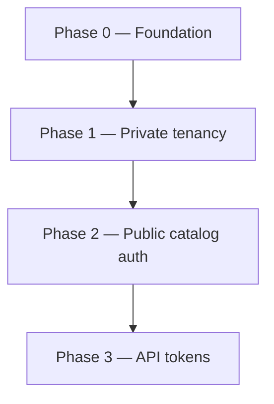

# ADR 001: Multi-tenant core & portfolio auth

| Field | Value |
|-------|-------|
| **Status** | Proposed |
| **Date** | 2026-06-19 |
| **Branch** | `feat/multi-tenant` |
| **Deliverable** | 1 PR — merge to `main` with coordinated portfolio client update |

## Context

`profile-info` today is a single-owner profile system:

- Almost all GraphQL reads are `@Public()` (no authentication).
- All mutations require `UserRole.ADMIN`.
- No entity has an `ownerId`; data is globally shared.
- `slug` is globally unique on every top-level collection.
- `ResumeService` picks the first `ADMIN` user and aggregates all data.
- Domain events (`skill.deleted`, `organization.deleted`) operate globally across
  the entire database.

The goal is to evolve into a **multi-tenant** platform where each registered user
owns a private portfolio (experiences, educations, courses, projects) while
sharing a global catalog (skills, organizations) moderated by a platform operator.

The portfolio (public site) must authenticate without exposing write credentials.
Session JWTs are for the admin panel; portfolio integrations use **API tokens with
`QUERY` permission only** — never the same token that can mutate data.

User-submitted catalog changes (suggestions, moderation, local overrides) are
**out of scope** for this ADR. See [ADR 002](./002-collaborative-public-catalog.md).

### Constraints

- **Breaking changes are acceptable** during development on `feat/multi-tenant`.
  The portfolio client is updated in the **same release** as this ADR's merge to
  `main`. No external users depend on the API yet (single production user).
- **No formal data migration scripts** for now — the sole production user will be
  backfilled manually in MongoDB.
- **Admin UI is out of scope**; validation happens via GraphQL sandbox and
  automated tests.
- **One PR per ADR.** Implementation happens incrementally on the feature branch
  (small steps per session); the PR opens only when this ADR's Definition of Done
  is met.
- **Seeds:** 2 regular users + 1 super admin, each with isolated private data and
  at least one `QUERY` API token (phase 3).

### Non-goals (this ADR)

- User-submitted skill/organization requests and moderation ([ADR 002](./002-collaborative-public-catalog.md)).
- Team / organization accounts (B2B tenants with multiple members).
- Billing, custom domains, or per-tenant infrastructure.
- Admin-panel changes (deferred until API is stable).

---

## Decision

### 1. Tenant model

**A tenant is a `User`.** Each user owns their private entities. There is no
separate `Tenant` collection in this iteration.

```
Platform layer     →  Skill, Organization (global catalog, SUPER_ADMIN mutates)
Tenant layer       →  User + private entities (ownerId-scoped)
Public consumer    →  API token (QUERY scope) for portfolio sites
```

If teams are needed later, introduce `tenantId` on private entities without
changing the global catalog design.

### 2. Role model

Replace the implicit single-admin model with explicit platform roles:

| Role | Scope |
|------|-------|
| `USER` | Own private entities; read global catalog; manage own API tokens |
| `SUPER_ADMIN` | Full platform access: all tenants, global catalog mutations |

The existing `ADMIN` role is **renamed to `SUPER_ADMIN`**. Seeds and guards are
updated accordingly. The current production admin user becomes the first
`SUPER_ADMIN`.

`USER` gains mutation rights on **their own private entities** (today only
`ADMIN` can mutate anything).

### 3. Entity classification

#### Private entities (tenant-scoped)

`Experience`, `Education`, `Course`, `Project`

- Add required `ownerId: ObjectId` (ref → `User`).
- Queries and mutations are scoped to `ownerId`, except `SUPER_ADMIN` bypass.
- `slug` uniqueness becomes **compound**: `{ ownerId: 1, slug: 1 }` unique.

#### Public catalog (platform-scoped)

`Skill`, `Organization`

- Remain global collections (no `ownerId` on the canonical document).
- All authenticated `USER`s can **query** the global catalog.
- Only `SUPER_ADMIN` can **mutate** the canonical catalog directly.

#### User profile

`User` is neither fully private nor catalog:

- Authenticated users can read global user listings as needed for admin flows.
- Portfolio-facing reads resolve through the API-token auth path (phase 3).
- `updateMe` remains self-service; `SUPER_ADMIN` retains full user CRUD.

### 4. Authentication model

Remove `@Public()` from entity operations. **All GraphQL operations require
authentication**, except `signIn`.

Two credential types coexist:

| Credential | Use case | Lifetime |
|------------|----------|----------|
| **Session JWT** | Admin panel login (`signIn`) | Short (current: 8h) |
| **API token** | Portfolio / public integrations | User-chosen expiry (including none) |

#### API tokens

- Stored hashed (never persist plaintext after creation).
- Belong to the creating user (tenant scope).
- Permissions (enum):
  - `QUERY` — read operations for the token owner's tenant data + global catalog
  - `MUTATE` — write operations for the token owner's private entities
- Portfolio tokens **must** be issued with `QUERY` only — the public site must
  never embed a token that can mutate data.
- Guard resolves credential → `RequestContext` with `{ userId, role, permissions }`.

`signIn` continues to return a session JWT with full user permissions (no
separate token permission flags on JWT).

### 5. Request context and authorization

Introduce a `RequestContext` (or equivalent) populated by the auth guard:

```typescript
interface RequestContext {
  userId: string;
  role: UserRole;
  permissions?: ApiTokenPermission[]; // absent for session JWT (= full access)
  isSuperAdmin: boolean;
}
```

Authorization rules:

1. **Private reads/writes** — filter by `ownerId === context.userId`, unless
   `isSuperAdmin`.
2. **Global catalog reads** — any authenticated caller; API tokens with `QUERY`.
3. **Global catalog writes** — `SUPER_ADMIN` only (direct mutations).
4. **API token writes** — require `MUTATE` permission + ownership check.
5. **IDOR prevention** — every `findOneById`, `updateOne`, `removeOne`, and
   DataLoader batch must apply tenant filters; never trust client-supplied IDs alone.

Implement filtering at the **repository/service layer**, not only in resolvers,
to prevent accidental data leaks.

### 6. Domain events

Events remain the delete-cascade mechanism. In this ADR there are no local
catalog overrides ([ADR 002](./002-collaborative-public-catalog.md)); behavior
stays global but must remain **multi-tenant safe**:

| Event | Behavior |
|-------|----------|
| `skill.deleted` | `$pull` skill ID from all private entities that reference it (all tenants) |
| `organization.deleted` | `deleteMany` on all private entities referencing the org (all tenants); super-admin action |

Emit events **before** delete (unchanged). Listeners stay thin. A
`SUPER_ADMIN` deleting a global org or skill affects every tenant that
references it — that is intentional for the canonical catalog.

### 7. Peripheral modules

| Module | Change |
|--------|--------|
| `resume` | Require auth; resolve profile from `RequestContext` (or explicit `userId` for super-admin). Remove "first ADMIN" heuristic. `GET /resume.pdf` requires API token or session JWT. |
| `dashboard` | Scope counts to `ownerId`; super-admin gets platform-wide dashboard. |
| `ai-tools` | Scope to authenticated user's private entities (or super-admin). |
| `users` | Remove public reads; portfolio access via API token. |

### 8. Seeds and testing

`src/seed.ts` after all phases:

- 1 × `SUPER_ADMIN` (`super@profile.info`)
- 2 × `USER` (`user-a@profile.info`, `user-b@profile.info`)
- Distinct private entities per user (overlapping slugs allowed across users).
- Shared global skills/organizations.
- At least 1 `QUERY` API token per user (plaintext shown once in seed output).

**Tenant isolation tests** are a CI gate from phase 1a onward:

- User A cannot read/update/delete user B's private entities.
- API token with `QUERY` cannot mutate.
- Non-`SUPER_ADMIN` cannot mutate global catalog.

---

## Definition of Done (merge gate)

This ADR is complete when **all** of the following are true:

1. **Admin multi-tenant:** each `USER` CRUDs only their portfolio; `SUPER_ADMIN`
   sees all tenants and mutates the global catalog.
2. **Auth everywhere:** no `@Public()` except `signIn`; unauthenticated → 401.
3. **API tokens:** CRUD via GraphQL; guard accepts `Bearer <api-token>`;
   `QUERY` / `MUTATE` enforced.
4. **Portfolio path:** documented `QUERY`-only token flow; seed includes example
   token per user.
5. **Tests:** tenant isolation + token permission tests pass in CI.
6. **Docs:** `ER_MODEL.md` and `agents/api.md` updated.
7. **Portfolio client:** updated in the same release to send `Authorization:
   Bearer <query-token>` on all API calls (no session JWT, no `MUTATE` token in
   the public bundle).

---

## Migration phases

Work happens on `feat/multi-tenant`. Merge to `main` is a **single coordinated
release** with the portfolio client.



Phases 0–3 ship in **one PR** for this ADR. Implementation order below is for
**incremental work on the branch** (one Cursor session per step; ~8–25 files each).

### Phase 0 — Foundation

| Step | Deliverable | Done when |
|------|-------------|-----------|
| 0a | `SUPER_ADMIN` role replaces `ADMIN` | Enum, guards, seeds, specs updated |
| 0b | `RequestContext` type + guard plumbing | Context available in resolvers/services |
| 0b | `ownerId` on private schemas (nullable) | Schema compiles |
| 0b | Compound index `{ ownerId, slug }` on private collections | Index created |
| 0b | Seeds: 2 users + 1 super admin | `npm run api:seed` succeeds |

### Phase 1 — Private tenancy

| Step | Deliverable | Done when |
|------|-------------|-----------|
| 1a | **Experience** — `ownerId` end-to-end | First tenant isolation e2e test passes |
| 1b | **Education** — same pattern | Isolation holds for education |
| 1c | **Course** — same pattern | Isolation holds for course |
| 1d | **Project** — same pattern | Isolation holds for project |
| 1e | `resume`, `dashboard` scoped to tenant | No global aggregation |
| 1f | `ai-tools`, `users` reads scoped | No public user reads |
| — | `ownerId` required on create; prod backfill manual | No orphan private docs |
| — | Remove `@Public()` from private entity resolvers | Unauthenticated → 401 |
| — | Update `ER_MODEL.md` | Docs in sync |

### Phase 2 — Public catalog authorization

| Step | Deliverable | Done when |
|------|-------------|-----------|
| 2a | **Skills** — queries require auth; mutations `SUPER_ADMIN` | USER cannot mutate skills |
| 2b | **Organizations** — same + domain event review | Deletes remain multi-tenant safe |
| — | Seeds include shared global catalog | Both users see same skills/orgs |

### Phase 3 — API tokens

| Deliverable | Done when |
|-------------|-----------|
| `ApiToken` collection (hashed secret, permissions, expiry) | CRUD via GraphQL |
| Auth guard accepts `Authorization: Bearer <api-token>` | Token resolves to owner context |
| Permission enforcement (`QUERY` / `MUTATE`) | Tests pass |
| Remove remaining `@Public()` (except `signIn`) | All routes authenticated |
| Seed: `QUERY` token per user | Sandbox + portfolio integration ready |

---

## Portfolio migration checklist

Part of the merge gate (Definition of Done §7):

1. User creates a token with **`QUERY` permission only** (admin or seed).
2. Portfolio client sends `Authorization: Bearer <token>` on every GraphQL query.
3. **No `MUTATE` token** in frontend bundles, env vars committed to the public
   repo, or browser-accessible storage.
4. `GET /resume.pdf` (if used) authenticated via `QUERY` token or documented
   alternative.
5. Portfolio deployed in the **same release** as API merge to `main`.

---

## Data model changes (summary)

### Private entities (Experience, Education, Course, Project)

```typescript
// Added field
ownerId: ObjectId; // ref User, required, indexed

// Index change
{ ownerId: 1, slug: 1 } // unique (replaces global slug unique)
```

### ApiToken (new collection)

```typescript
{
  userId: ObjectId;        // ref User, indexed
  name: string;            // user label, e.g. "Portfolio production"
  hashedSecret: string;
  permissions: ('QUERY' | 'MUTATE')[];
  expiresAt?: Date;       // null = no expiry
  lastUsedAt?: Date;
  createdAt, updatedAt;
}
```

---

## Permission matrix

| Action | USER (session) | SUPER_ADMIN | API token QUERY | API token MUTATE |
|--------|----------------|-------------|-----------------|------------------|
| Sign in | ✓ | ✓ | — | — |
| Read own private entities | ✓ | ✓ | ✓ | ✓ |
| Read other's private entities | ✗ | ✓ | ✗ | ✗ |
| Mutate own private entities | ✓ | ✓ | ✗ | ✓ |
| Mutate other's private entities | ✗ | ✓ | ✗ | ✗ |
| Read global catalog | ✓ | ✓ | ✓ | ✓ |
| Mutate global catalog (direct) | ✗ | ✓ | ✗ | ✗ |
| Manage own API tokens | ✓ | ✓ | ✗ | ✗ |
| Manage users | ✗ | ✓ | ✗ | ✗ |

Submit/moderate catalog requests → [ADR 002](./002-collaborative-public-catalog.md).

---

## Consequences

### Positive

- Clear tenant isolation boundary (`ownerId`) enables safe multi-user operation.
- API tokens decouple portfolio auth from admin sessions; `QUERY`-only tokens
  avoid exposing write credentials on public sites.
- Phased implementation on a long-lived branch; single deliverable PR per ADR.

### Negative / risks

| Risk | Mitigation |
|------|------------|
| IDOR if filter omitted in one resolver | Repository-level enforcement + isolation test suite |
| Large PR (~90–120 files) | Incremental steps on branch; one session per step |
| `organization.deleted` cascade affects all tenants | Intentional for canonical catalog; document super-admin impact |
| Breaking portfolio during development | Accepted on feature branch; client updated before `main` merge |
| API token leakage in browser DevTools | `QUERY`-only tokens in portfolio; rate limiting (future) |

### Follow-ups (post-merge)

- [ADR 002](./002-collaborative-public-catalog.md) — collaborative catalog.
- Rate limiting per API token.
- Token rotation and audit log.
- Admin UI for multi-tenant + token management.
- Consider `tenantId` abstraction if team accounts are needed.

---

## References

- [ADR 002](./002-collaborative-public-catalog.md) — user-submitted catalog changes
- `apps/api/docs/ER_MODEL.md` — persistence model
- `agents/api.md` — API package context
- `apps/api/docs/CLEAN_ARCHITECTURE.md` — module layering and dependency rules
