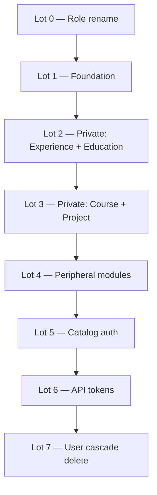

# ADR 001: Multi-tenant core & API tokens

| Field | Value |
|-------|-------|
| **Status** | In progress |
| **Date** | 2026-06-19 |
| **Branch** | `feat/multi-tenant` |
| **Deliverable** | 1 PR — backend only; merge when Definition of Done is met |

## Context

`profile-info` today is a single-owner profile system:

- Almost all GraphQL reads are `@Public()` (no authentication).
- All mutations require `UserRole.ADMIN`.
- No entity has an `ownerId`; data is globally shared.
- `slug` is globally unique on every top-level collection.
- `ResumeService` picks the first `ADMIN` user and aggregates all data.
- Domain events (`skill.deleted`, `organization.deleted`) operate globally across
  the entire database.

The goal is to evolve the **API** into a multi-tenant backend where each user
owns a private portfolio (experiences, educations, courses, projects) while
sharing a global catalog (skills, organizations) moderated by a platform operator.

Public consumers (portfolio sites) authenticate via **API tokens** with separate
permissions (`QUERY` / `MUTATE`) so read-only integrations never need a token that
can write.

**Scope of this ADR: backend only.** Admin panel, portfolio client, and test-suite
overhaul are out of scope — see [backlog](./backlog.md). The admin app is updated
independently for GraphQL contract changes (e.g. `BatchEntity`).

### Progress (2026-06-23)

| Area | State |
|------|--------|
| `SUPER_ADMIN` rename | Done |
| `ownerId` + compound slug index on private schemas | Done |
| `RequestContext` + helpers (`toRequestContext`, `isSuperAdmin`, …) | Done — resolvers pass `ctx`; services do not enforce tenancy yet |
| `core/persistence/` (`CrudRepository`, `StatsRepository`, `TenantScopedRepository`) | Done — unit-tested |
| Entity repositories extend `CrudRepository`; stats composed where needed | Done |
| Services migrated to `*OneById` / `*ManyById` / batch `BatchCount` | Done — all CRUD modules |
| GraphQL `BatchEntity { succeeded, failed }` | Done — API + admin codegen |
| `TenantScopedRepository` composed in entity repos | **Next** — courses pilot |
| `toTenantScope(ctx)` + services call `repository.tenant.*` | **Next** |
| Remove `@Public()` / tenant isolation e2e | Pending (lots 2–3) |
| API tokens | Pending (lot 6) |

### Constraints

- **Breaking changes are acceptable** on `feat/multi-tenant`. No external users
  depend on the API yet (single production user). Production data can be wiped and
  re-seeded; **seeds must work** (`npm run api:seed`).
- **No data migration scripts** — prefer a clean database over hours debugging
  legacy state.
- **One PR for this ADR.** Work ships in **implementation lots** on the feature
  branch (see [Implementation lots](#implementation-lots)); do not start the next
  lot until the current lot's gate passes. Target **≤ ~35 files changed per lot**
  to keep review and IDE sessions safe.
- **Seeds:** 2 regular users + 1 super admin, isolated private data, shared global
  catalog, at least one `QUERY` API token per user (phase 3).

### Non-goals (this ADR)

- Admin panel or portfolio client changes.
- User self-registration (accounts created manually for now).
- Collaborative catalog (user-submitted skill/org requests).
- Team accounts, billing, custom domains.
- Formal production migration runbooks.

---

## Decision

### 1. Tenant model

**A tenant is a `User`.** Each user owns their private entities. No separate
`Tenant` collection.

```
Platform layer     →  Skill, Organization (global catalog, SUPER_ADMIN mutates)
Tenant layer       →  User + private entities (ownerId-scoped)
Public consumer    →  API token (typically QUERY) for read integrations
```

### 2. Role model

| Role | Scope |
|------|-------|
| `USER` | Own private portfolio; read global catalog; own dashboard & AI tools (session JWT); manage own API tokens (session JWT) |
| `SUPER_ADMIN` | Platform operator: global catalog mutations; read/write any tenant's private entities by explicit ID; **does not maintain a personal portfolio** |

`ADMIN` is **renamed to `SUPER_ADMIN`**. Seeds and guards updated accordingly.

`USER` gains mutation rights on **their own private entities** (today only
`ADMIN` can mutate anything).

`SUPER_ADMIN` is not a portfolio user — the operator uses a regular `USER`
account for their own profile and reserves `SUPER_ADMIN` for system-wide
management (catalog, supporting other tenants).

### 3. Entity classification

#### Private entities (tenant-scoped)

`Experience`, `Education`, `Course`, `Project`

- Required `ownerId: ObjectId` (ref → `User`).
- **`USER`:** `ownerId` injected by the service from `ctx.userId` — never from input.
- **`SUPER_ADMIN`:** on **create**, `ownerId` is **required in input** (always
  targets another user's portfolio; the operator does not create private entities
  for themselves). On read/update/delete, operates by explicit entity ID with no
  tenant filter.
- `slug` uniqueness: compound `{ ownerId: 1, slug: 1 }` unique.

#### Public catalog (platform-scoped)

`Skill`, `Organization`

- Global collections (no `ownerId` on canonical documents).
- Authenticated callers can **query**.
- Only `SUPER_ADMIN` can **mutate** directly.

#### User profile

- `getMe` works with session JWT and API token `QUERY` (returns the token
  owner's profile, including email — acceptable for portfolio use).
- `updateMe` remains self-service for session JWT only (not API tokens).
- `SUPER_ADMIN` retains full user CRUD.
- Other user listing/detail queries require session JWT (not API tokens).

### 4. Persistence layer

MongoDB access for feature modules lives in `core/persistence/` — generic,
domain-agnostic, and tested in isolation.

#### `CrudRepository<T>`

Base class for all entity repositories. Naming convention:

| By id | By filter |
|-------|-----------|
| `findOneById`, `findManyById` | `findOne`, `findMany` (paginated) |
| `createOne`, `createMany` | — |
| `updateOneById`, `updateManyById` | `updateOne`, `updateMany` |
| `deleteOneById`, `deleteManyById` | `deleteOne`, `deleteMany` |

Return types: `*One` → document; `findMany` → `{ nodes, found }`; batch mutations
→ `BatchCount { succeeded, failed }`. Partial batch success is allowed; errors
fire only when `succeeded === 0` (`assertBatchSucceeded`). Filter-based
`updateMany` / `deleteMany` are for **global cascades** (listeners), not
tenant-scoped user operations.

#### `StatsRepository<T>`

`count()`, `countByField()`, `findRecentlyUpdated()`. Composed explicitly on
entity repositories that feed dashboard metrics:

```typescript
readonly stats = new StatsRepository(model);
```

Not every repository needs stats (e.g. `UsersRepository`).

#### `TenantScopedRepository<T>`

Composition wrapper over `CrudRepository` — **does not extend** `CrudRepository`
(so unscoped methods are not exposed on the same object).

- `withTenantScope(scope, filter)` adds `ownerId: scope.userId` when
  `crossTenant: false`; `crossTenant: true` bypasses scope (`SUPER_ADMIN`).
- `createOne` / `createMany` inject `ownerId` for tenants.
- `findManyUnscoped` for public portfolio reads (no `ownerId` filter).
- No filter-based `updateMany` / `deleteMany` — cascades use raw `CrudRepository`.

Entity module pattern (owner-scoped entities):

```typescript
@Injectable()
export class CoursesRepository extends CrudRepository<CourseModel> {
  readonly stats: StatsRepository<CourseModel>;
  readonly tenant: TenantScopedRepository<CourseModel>;

  constructor(@InjectModel(CourseModel.name) model: Model<CourseModel>) {
    super(model);
    this.stats = new StatsRepository(model);
    this.tenant = new TenantScopedRepository(this);
  }
}
```

Global catalog repos (`Skill`, `Organization`) extend `CrudRepository` only
(+ `stats` if needed).

#### GraphQL batch type

`BatchEntity { succeeded, failed }` mirrors `BatchCount`. Services return batch
results from the repository directly — no extra mapping layer.

### 5. Authorization pattern

Replace the blanket `@Roles(SUPER_ADMIN)` on private-entity mutations with
**ownership + role** checks.

#### Resolver responsibility

The resolver is the **entry point** for auth context:

1. Obtain `RequestContext` from the auth guard (`@CurrentUser()` / dedicated
   decorator).
2. Pass `RequestContext` as the **first argument** to every service method that
   touches tenant-scoped or role-gated data.
3. Remove `@Roles(SUPER_ADMIN)` from private-entity mutations and from `dashboard` /
   `ai-tools` (any authenticated user calls them).
4. Keep `@Roles(SUPER_ADMIN)` on global catalog mutations and user CRUD (or
   equivalent check in service).

The resolver does **not** duplicate per-entity ownership logic — it only forwards
context.

#### Service responsibility

Services stay unified (no separate “admin service” vs “user service”). Each method
receives `RequestContext` and delegates tenant-scoped I/O to
`repository.tenant.*`:

```typescript
function toTenantScope(ctx: RequestContext): TenantScope {
  return { userId: ctx.userId, crossTenant: isSuperAdmin(ctx) };
}

// Example — CoursesService
findMany(ctx, query) {
  return this.repository.tenant.findMany(toTenantScope(ctx), query);
}

createOne(ctx, input) {
  return this.repository.tenant.createOne(toTenantScope(ctx), input);
}
```

Global cascades (`detachSkill`, `purgeByOrganization`) call
`repository.updateMany` / `repository.deleteMany` on the raw CRUD repo — no
tenant filter.

| Operation | `USER` / API token | `SUPER_ADMIN` (session JWT) |
|-----------|-------------------|----------------------------|
| List / find (scoped) | `repository.tenant.*` with `crossTenant: false` | `crossTenant: true` or by explicit ID |
| Create | `ownerId` injected by `TenantScopedRepository` | `ownerId` from input (required) |
| Update / delete by ID | `repository.tenant.*` → 404 if not owner | `crossTenant: true` |
| Batch update / delete | Each ID scoped via `tenant` wrapper | `crossTenant: true` |

**IDOR rule (USER only):** guessing another tenant's ID returns **404** (not 403),
because the query includes `ownerId` and finds nothing.

#### API token permission checks

Enforced in the guard or a thin permissions layer before the resolver:

- `QUERY` — portfolio reads: `getMe`, private-entity queries, global catalog queries.
  No `dashboard`, no `ai-tools`, no user CRUD, no token management.
- `MUTATE` — private-entity writes only (not global catalog, not token CRUD, not
  `dashboard` / `ai-tools`, not `getMe`).
- **Combined `QUERY` + `MUTATE`** on one token — allowed in storage (`permissions[]`).
  Typical tokens use a single permission; both together act as a “full portfolio”
  credential (read + write for the token owner). Permission checks use
  `permissions.includes(required)` per operation.
- Session JWT — full access for the user's role (no permission enum).

**Why `MUTATE`-only tokens cannot call `getMe`:** write-only integrations do not need
profile reads — the token is already bound to one user. Read the portfolio via entity
queries, or issue a `QUERY` token (or a combined `QUERY` + `MUTATE` token) when the
integration also needs profile metadata.

API tokens cannot manage other API tokens — only a logged-in user via session JWT
creates/revokes tokens (admin panel; front out of scope).

### 6. `ownerId` rules

| Caller | Create | Update | Read / delete |
|--------|--------|--------|---------------|
| `USER` | Service sets `ownerId = ctx.userId` | **`ownerId` immutable** — strip from payload | `tenantFilter(ctx)` on every op (incl. batch) |
| API token | Same as `USER` | Same as `USER` | Same as `USER` |
| `SUPER_ADMIN` | `ownerId` **required in create input** | **`ownerId` immutable** — no reassignment | No `ownerId` filter; operate by explicit ID |

- `USER` and API tokens: `ownerId` is **not** an accepted input field on create
  (injection only).
- `SUPER_ADMIN` may pass `ownerId` on create only; the service rejects create without it.
- **No owner transfer on update** (any role). To move data between tenants: delete under
  the wrong owner and recreate under the correct owner (see [backlog](./backlog.md) if
  bulk transfer is ever needed).

#### Filter inputs

Filter DTOs use **`PartialType(PickType(Create*Input, [...]))`** — an explicit whitelist
of filterable fields. Never `PartialType(Create*Input)` wholesale (that would inherit
future create-only fields like `ownerId`). **`ownerId` is never a filter field**; tenant
scope comes only from `RequestContext` via `TenantScopedRepository` (not from
filter inputs). `FilterUserInput` excludes `password`.

### 7. Authentication model

#### GraphQL

All GraphQL operations require authentication **except `signIn`**.

#### REST (exceptions)

| Route | Auth |
|-------|------|
| `GET /health` | Public (ops) |
| `GET /resume.pdf` | Fully public; `userId` query param selects whose resume to build. Anyone with a valid user ID can download — acceptable for now. |

Token-based REST auth is deferred — see [backlog](./backlog.md).

#### Two credential types (GraphQL)

| Credential | Use case | Lifetime |
|------------|----------|----------|
| **Session JWT** | Admin panel (`signIn`) | Short (current: 8h) |
| **API token** | Portfolio / integrations | User-chosen expiry (including none) |

#### API token format and guard resolution

Industry-standard pattern for JWT + opaque API tokens sharing `Authorization: Bearer`:

1. **Prefix:** secrets start with `pi_` (profile-info). Example:
   `pi_a1b2c3d4e5f6…` (prefix + 32 random bytes as base64url).
2. **Storage:** persist only a **bcrypt hash** of the full secret; plaintext
   returned **once** on create (GraphQL field on the create mutation response).
3. **Guard resolution order:**
   - Extract Bearer token.
   - If token starts with `pi_` → look up by hash, build `RequestContext` with
     `credentialKind: 'api_token'` and `permissions` from the stored record.
   - Else → existing JWT validation (`passport-jwt`).

JWTs contain dots (`header.payload.signature`); prefixed opaque tokens are
unambiguous — no double-decode attempts.

**Deferred:** `lastUsedAt`, per-user token limits, rotation UI — see [backlog](./backlog.md).

```typescript
type RequestContext =
  | {
      userId: string;
      role: UserRole;
      credentialKind: "session";
    }
  | {
      userId: string;
      role: UserRole;
      credentialKind: "api_token";
      permissions: ApiTokenPermission[]; // one or both per token
    };

// Role and credential checks live in helpers (e.g. isSuperAdmin(ctx), isSession(ctx),
// isApiToken(ctx), hasPermission(ctx, ApiTokenPermission.QUERY)).
```

### 8. Domain events

Global catalog deletes affect all tenants that reference the entity — intentional.

| Event | Behavior |
|-------|----------|
| `skill.deleted` | `$pull` skill ID from all private entities that reference it |
| `organization.deleted` | `deleteMany` on all private entities referencing the org (all tenants) |
| `user.deleted` | `deleteMany` on all private entities with that `ownerId`; `deleteMany` on `ApiToken` for that `userId`. **`SUPER_ADMIN` users cannot be deleted** (lot 7). |

Emit **before** delete (unchanged). Listeners stay thin.

### 9. Peripheral modules

| Module | Change |
|--------|--------|
| `resume` | `buildResume(userId)` — stop "first ADMIN" heuristic. `GET /resume.pdf?userId=&locale=` stays `@Public()`. |
| `dashboard` | Session JWT only. Pass `RequestContext`; scope counts to `ownerId`. `SUPER_ADMIN` sees platform-wide totals. |
| `ai-tools` | Session JWT only. Any `USER` or `SUPER_ADMIN` (no paid plan gate yet). |
| `users` | Remove `@Public()` from reads; `SUPER_ADMIN` for user CRUD mutations. |

### 10. Seeds and testing

Minimum CI gate from phase 1a:

- User A cannot read/update/delete User B's private entities (by ID or batch).
- API token with `QUERY` cannot mutate.
- Non-`SUPER_ADMIN` cannot mutate global catalog.

Full test-suite overhaul is deferred — see [backlog](./backlog.md).

---

## Definition of Done (merge gate)

Backend only:

1. Each `USER` CRUDs only their private entities; `SUPER_ADMIN` manages any
   tenant's private entities (create with `ownerId` in input) and mutates global catalog.
2. GraphQL: no `@Public()` except `signIn`; unauthenticated → 401.
3. `GET /health` and `GET /resume.pdf?userId=` remain fully public.
4. API tokens: CRUD via session JWT only; `pi_` prefix + hash storage; guard
   resolves JWT vs token; `QUERY` / `MUTATE` enforced per permission matrix.
5. `USER`: `ownerId` injected on create; immutable on update; `SUPER_ADMIN` create requires `ownerId` in input.
6. `npm run api:seed` produces 2 users + 1 super admin + sample tokens + isolated data.
7. Tenant isolation + token permission tests pass.
8. `ER_MODEL.md` reflects tenancy, cascade deletes, and `ApiToken`.
9. `SUPER_ADMIN` cannot be deleted; deleting a `USER` cascades private data + tokens.

---

## Implementation lots

**Rules**

1. **One lot at a time.** Finish the current lot completely before starting the next.
2. **Gate before moving on:** automated checks green + manual checklist done (below).
3. **Lot size:** aim for ≤ ~35 files per lot (~15–25 is ideal). If a lot grows
   beyond that during implementation, split it before continuing.
4. **Branch hygiene:** one commit (or a small commit series) per lot on
   `feat/multi-tenant`; open the ADR PR only when all lots are done.
5. **Do not** implement catalog auth, API tokens, or peripheral modules while
   still on an earlier lot — avoids half-migrated state and giant diffs.

Phases 0–3 map to **8 lots**. Lots 1–2 establish the pattern; lots 3–4 repeat it
for the remaining private entities in pairs (not one entity per session — not
everything at once either).



### Lot 0 — Role rename

| | |
|---|---|
| **Scope** | `ADMIN` → `SUPER_ADMIN` in enum, guards, specs, seed, e2e fixtures |
| **~Files** | 8–12 |
| **Out of scope** | `ownerId`, `RequestContext`, tenancy |

**Automated gate:** `npm run lint` · `npm run api:test` (existing suite green with renamed role)

**Manual gate (GraphQL sandbox):**
- [ ] `signIn` as super admin seed user → JWT works
- [ ] `signIn` as regular user → JWT works
- [ ] Mutation that still requires old admin role now requires `SUPER_ADMIN`

---

### Lot 1 — Foundation (persistence + plumbing)

Split into three checkpoints on the feature branch. **Do not start lot 2 until
1c is complete.**

#### Lot 1a — Persistence layer ✅

| | |
|---|---|
| **Scope** | `core/persistence/`: `CrudRepository`, `StatsRepository`, `TenantScopedRepository`, `BatchCount`, helpers, unit specs |
| **~Files** | ~15 |
| **Gate** | `npm run api:test` — persistence specs green |

#### Lot 1b — Repository & service migration ✅

| | |
|---|---|
| **Scope** | All entity repos extend `CrudRepository`; stats composed where needed; services use `*OneById` / batch API; `BatchEntity { succeeded, failed }`; service unit specs updated |
| **~Files** | ~25 |
| **Gate** | `npm run api:build` · `npm run api:test` (135+ unit tests) |

Admin: regenerate codegen after `schema.gql` batch-type change (`succeeded` /
`failed` on batch mutations).

#### Lot 1c — Tenant wiring (in progress)

| | |
|---|---|
| **Scope** | `toTenantScope(ctx)` in `core/context/`; compose `readonly tenant` on owner-scoped repos; **courses pilot** — service calls `repository.tenant.*`; seeds set `ownerId` |
| **~Files** | ~12–18 |
| **Out of scope** | Removing `@Public()`, other private entities, API tokens |

**Automated gate:** `npm run lint` · `npm run api:test` · `npm run api:seed`

**Manual gate:**
- [ ] User A creates course → only A lists/sees it
- [ ] User B `findOneCourseById` with A's ID → not found
- [ ] Super admin `crossTenant` sees all courses

---

### Lot 1 (legacy note)

Earlier drafts combined schema + `RequestContext` + filter DTOs in a single lot.
`ownerId` on private schemas and `RequestContext` plumbing are done; filter DTO
whitelists and tenancy enforcement follow lots 1c–3 below.


### Lot 2 — Private tenancy (Experience + Education)

| | |
|---|---|
| **Scope** | Full `tenantFilter` pattern for **Experience** and **Education**: resolver passes `RequestContext` → service; `ownerId` injected on create (`USER`); `ownerId` required in create input (`SUPER_ADMIN`); remove `@Public()` on both resolvers; **first tenant isolation e2e tests** |
| **~Files** | 20–30 |
| **Out of scope** | Course, Project, resume, dashboard, catalog, tokens |

**Automated gate:** `npm run lint` · `npm run api:test` · new/updated e2e: User A cannot read/update/delete User B's experience or education (by ID and batch)

**Manual gate (sandbox, two user tokens):**
- [ ] User A creates experience → only A lists/sees it
- [ ] User B `findOneExperienceById` with A's ID → error / not found
- [ ] Unauthenticated query on experience → `UNAUTHENTICATED`
- [ ] Super admin creates education with `ownerId` for user A → A sees it, B does not

---

### Lot 3 — Private tenancy (Course + Project)

| | |
|---|---|
| **Scope** | Same pattern as lot 2 for **Course** and **Project**; extend isolation e2e to cover both |
| **~Files** | 20–30 |
| **Out of scope** | Peripheral modules, catalog, tokens |

**Automated gate:** `npm run lint` · `npm run api:test` · isolation tests cover all 4 private entity types

**Manual gate:**
- [ ] User A / B isolation holds for course and project
- [ ] `ownerId` required on create (no orphan docs without owner)
- [ ] Overlapping slugs across users on same entity type work (compound unique index)

---

### Lot 4 — Peripheral modules

| | |
|---|---|
| **Scope** | `resume` — `buildResume(userId)`, public `GET /resume.pdf?userId=`; `dashboard` — session JWT, scoped to `ownerId` (super admin: platform-wide); `ai-tools` — session JWT, any `USER`; `users` — remove `@Public()` on reads |
| **~Files** | 12–20 |
| **Out of scope** | Skills/orgs auth changes, API tokens |

**Automated gate:** `npm run lint` · `npm run api:test` · update `resume.e2e-spec.ts` / `dashboard.e2e-spec.ts` as needed for new auth/scoping

**Manual gate:**
- [ ] `GET /resume.pdf?userId=<seed-user-a>` returns PDF; wrong/missing user handled
- [ ] Dashboard counts differ per user; super admin sees aggregate
- [ ] `findManyUsers` without token → `UNAUTHENTICATED`
- [ ] AI mutation works as `USER` with session JWT

---

### Lot 5 — Catalog auth

| | |
|---|---|
| **Scope** | **Skills** + **Organizations**: auth on all queries; mutations `SUPER_ADMIN` only; domain events unchanged; seeds include shared global catalog for both users |
| **~Files** | 14–22 |
| **Out of scope** | API tokens, removing `@Public()` from users if not done in lot 4 |

**Automated gate:** `npm run lint` · `npm run api:test` · e2e: USER cannot `createOneSkill`; unauthenticated skill query → `UNAUTHENTICATED`

**Manual gate:**
- [ ] Both users read same skill list after seed
- [ ] User `createOneSkill` → forbidden
- [ ] Super admin `createOneSkill` → success

---

### Lot 6 — API tokens + docs

| | |
|---|---|
| **Scope** | `ApiToken` module (CRUD, `pi_` prefix, bcrypt hash, plaintext once on create); guard resolves `pi_` vs JWT; `QUERY` / `MUTATE` enforcement per permission matrix (including combined permissions); remove remaining GraphQL `@Public()` (except `signIn`); seed: `QUERY` token per user |
| **~Files** | 25–35 |
| **Out of scope** | Frontends, full test overhaul ([backlog](./backlog.md)) |

**Automated gate:** `npm run lint` · `npm run api:test` · e2e: `QUERY` token reads own data + `getMe`; `QUERY` cannot mutate; `MUTATE` cannot call `getMe` / dashboard / AI; token CRUD requires session JWT

**Manual gate:**
- [ ] Create token in sandbox → plaintext shown once; subsequent list shows no secret
- [ ] `Authorization: Bearer pi_…` resolves to token owner context
- [ ] `Authorization: Bearer <jwt>` still works
- [ ] `npm run api:seed` prints sample `QUERY` token per user

**ADR complete** when lot 7 gate passes and [Definition of Done](#definition-of-done-merge-gate) is satisfied.

---

### Lot 7 — User cascade delete

| | |
|---|---|
| **Scope** | `user.deleted` domain event; listeners delete all private entities with matching `ownerId` and all `ApiToken` rows for that user; **`removeOneUser` / `removeManyUsers` reject `SUPER_ADMIN`** targets; e2e: delete USER removes their courses/experiences/etc.; cannot delete super admin |
| **~Files** | 12–18 |
| **Out of scope** | Soft delete, owner transfer mutation |

**Automated gate:** `npm run lint` · `npm run api:test` · e2e/integration: USER delete cascades private data + tokens; SUPER_ADMIN delete → forbidden

**Manual gate:**
- [ ] Seed user A deleted → A's private entities gone; B's unchanged
- [ ] Attempt delete super admin → error
- [ ] No orphan private docs with dangling `ownerId` after user delete

---

## Migration phases (summary)

High-level grouping of the lots above:

| Phase | Lots |
|-------|------|
| 0 — Foundation | 0, 1 |
| 1 — Private tenancy | 2, 3, 4 |
| 2 — Catalog auth | 5 |
| 3 — API tokens | 6 |
| 4 — Lifecycle | 7 |

---

## Data model changes

### Private entities

```typescript
ownerId: ObjectId; // ref User, required
// USER: service-injected on create
// SUPER_ADMIN: required in create input
// unique: { ownerId: 1, slug: 1 }
```

### ApiToken (new collection)

```typescript
{
  userId: ObjectId;
  name: string;
  hashedSecret: string;
  permissions: ('QUERY' | 'MUTATE')[]; // one or both per token
  expiresAt?: Date;
  createdAt, updatedAt;
}
```

---

## Permission matrix

| Action | USER (session) | SUPER_ADMIN (session) | API token QUERY | API token MUTATE |
|--------|----------------|----------------------|-----------------|------------------|
| Sign in | ✓ | ✓ | — | — |
| `getMe` | ✓ | ✓ | ✓ | ✗ |
| Read own private entities | ✓ | ✓ | ✓ | ✓ |
| Read other's private entities | ✗ | ✓ | ✗ | ✗ |
| Mutate own private entities | ✓ | ✗ | ✗ | ✓ |
| Mutate other's private entities | ✗ | ✓ (`ownerId` on create) | ✗ | ✗ |
| Read global catalog | ✓ | ✓ | ✓ | ✓ |
| Mutate global catalog | ✗ | ✓ | ✗ | ✗ |
| Dashboard | ✓ | ✓ | ✗ | ✗ |
| AI tools | ✓ | ✓ | ✗ | ✗ |
| Manage own API tokens | ✓ | ✓ | ✗ | ✗ |
| `updateMe` | ✓ | ✓ | ✗ | ✗ |
| Manage users | ✗ | ✓ | ✗ | ✗ |

`SUPER_ADMIN` does not mutate a personal portfolio — row "Mutate own private
entities" is intentionally ✗. The platform operator keeps a separate `USER` account
for their own profile; the `SUPER_ADMIN` role is for catalog and tenant support only.

**API token with both `QUERY` and `MUTATE`:** full portfolio access for the token
owner (union of the QUERY and MUTATE columns, including `getMe` + writes).

---

## Consequences

### Positive

- Single service layer with `repository.tenant` — no duplicated admin/user code paths.
- Prefixed API tokens avoid JWT ambiguity without extra headers.
- Backend-first delivery; frontends can catch up after API stabilizes.

### Negative / risks

| Risk | Mitigation |
|------|------------|
| IDOR on batch ops | `TenantScopedRepository` scopes every batch ID; partial batches return `{ succeeded, failed }` |
| Large PR | Eight implementation lots; gate per lot; ≤ ~35 files each |
| `resume.pdf` public with `userId` | Anyone can download any user's PDF if they know the ID — acceptable for now; see [backlog](./backlog.md) |
| CORS fixed to one origin | `*` or [backlog](./backlog.md) when second tenant has own domain |

---

## References

- [backlog](./backlog.md) — deferred work after ADR 001
- `apps/api/docs/ER_MODEL.md`
- `agents/api.md`
- `apps/api/docs/CLEAN_ARCHITECTURE.md`
