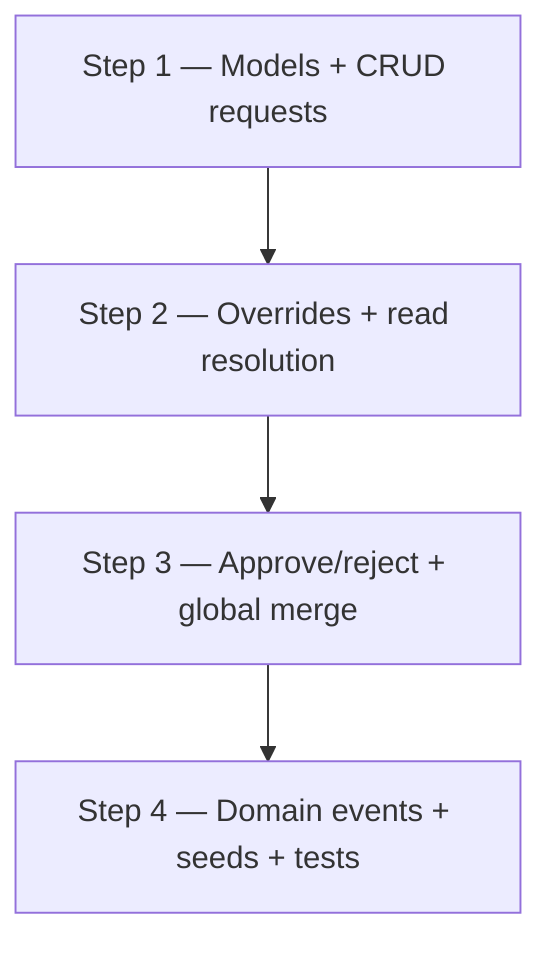

# ADR 002: Collaborative public catalog

| Field | Value |
|-------|-------|
| **Status** | Proposed |
| **Date** | 2026-06-19 |
| **Depends on** | [ADR 001](./001-multi-tenant-migration.md) (merged) |
| **Deliverable** | 1 PR — merge to `main` after ADR 001 is live |

## Context

[ADR 001](./001-multi-tenant-migration.md) establishes multi-tenant isolation, a
global skill/organization catalog mutated only by `SUPER_ADMIN`, and API tokens
for portfolio reads. Users consume the canonical catalog but cannot propose
changes.

In practice, tenants will disagree on naming and metadata (e.g. one user prefers
`React`, another `ReactJS`). Without a structured flow, users either live with
wrong labels or duplicate concepts outside the global catalog.

This ADR adds a **collaborative catalog**: users submit create/update requests;
`SUPER_ADMIN` moderates; pending or rejected proposals appear as **local
overrides** visible only to the submitting tenant until resolved.

### Constraints

- **Builds on ADR 001** — `ownerId`, `RequestContext`, roles, and API tokens
  must already be in production.
- **One PR per ADR.** Implement incrementally on a feature branch; open the PR
  when this ADR's Definition of Done is met.
- **Admin UI for moderation is optional** for the first merge; GraphQL sandbox
  and tests are sufficient to validate the API.
- **No mandatory portfolio client changes** — the public site keeps using
  `QUERY` tokens; override resolution happens server-side.

### Non-goals (this ADR)

- Team / organization accounts.
- Billing or per-tenant infrastructure.
- Full admin moderation UI (follow-up).
- Rate limiting on request submission (future).

---

## Decision

### 1. Data structures

```
Skill / Organization (canonical)   ← global, slug unique, SUPER_ADMIN mutates directly
PublicEntityRequest              ← approval queue (CREATE | UPDATE)
TenantCatalogOverride            ← per-user local version of a global entity
```

- Canonical `Skill` and `Organization` collections are unchanged from ADR 001.
- `PublicEntityRequest` stores user proposals awaiting review.
- `TenantCatalogOverride` stores the tenant-local view while a request is
  pending, rejected, or intentionally kept after a global merge.

### 2. Request lifecycle

1. `USER` (session JWT) submits a create or update request for a skill or
   organization.
2. Request enters `PENDING` state.
3. `SUPER_ADMIN` reviews requests grouped by target entity.
4. Admin **approves one or more** identical requests or **rejects all** pending
   requests for that target.

API tokens cannot submit or moderate requests (session JWT only).

### 3. Local overrides

- While a request is `PENDING` or `REJECTED`, the user's proposed version is
  stored in `TenantCatalogOverride` and visible **only to that user**.
- Private entities continue to reference global skill/org IDs; at read time the
  API resolves effective data as `override ?? global`.
- Submitting a request creates or updates the override atomically with the
  request record.

### 4. Global merge with exceptions

When admin approves a global change (e.g. rename `React` → `ReactJS`):

1. Update the canonical document.
2. Run a reference migration for all tenants **except** those with an active
   local override on that entity.
3. Tenants whose override already matches the new canonical value drop their
   override (dedup).
4. Tenants with a different local override keep it until they accept the global
   change or admin forces resolution.

#### Conflict example

| User | Request |
|------|---------|
| A | `React` → `React` (keep) |
| B | `React` → `Angular` |
| C | `React` → `ReactJS` |

Admin approves C:

- Global `React` becomes `ReactJS`.
- All references migrate to `ReactJS` except users A and B (local overrides).
- User C's override is removed (now matches global).

### 5. Domain events (override-aware)

Events from ADR 001 gain override awareness:

| Event | ADR 001 behavior | ADR 002 behavior |
|-------|------------------|------------------|
| `skill.deleted` | `$pull` from all referencing private entities | `$pull` from entities **without** a local override on that skill; override tenants handled separately |
| `organization.deleted` | `deleteMany` on all dependent private entities | `deleteMany` only on entities referencing the global org **and** without a local org override |

Emit events **before** delete (unchanged). Listeners stay thin.

### 6. Authorization additions

Extends the ADR 001 permission matrix:

| Action | USER (session) | SUPER_ADMIN | API token |
|--------|----------------|-------------|-----------|
| Submit public-entity request | ✓ | ✓ | ✗ |
| Moderate requests | ✗ | ✓ | ✗ |
| Read own overrides (via catalog resolution) | ✓ | ✓ | ✓ (QUERY) |
| Read other's overrides | ✗ | ✓ | ✗ |

Direct global catalog mutations remain `SUPER_ADMIN` only (unchanged from ADR 001).

---

## Definition of Done (merge gate)

This ADR is complete when **all** of the following are true:

1. `USER` can submit create/update requests for skills and organizations.
2. `SUPER_ADMIN` can list, approve, and reject requests.
3. `TenantCatalogOverride` exposes the user's version only to that tenant during
   pending/rejected states.
4. Approved global changes migrate references with override exceptions and dedup.
5. Domain events respect overrides on delete.
6. Seed scenario demonstrates a full moderation flow (submit → approve → merge).
7. Tests cover request lifecycle, override isolation, and merge edge cases.
8. `ER_MODEL.md` updated with new collections and delete behavior notes.

**Portfolio:** no client changes required. `QUERY` tokens continue to work;
resolved catalog data reflects overrides automatically for the token owner.

---

## Implementation phases

One PR for this ADR. Suggested incremental steps on the feature branch:



### Step 1 — Request model

| Deliverable | Done when |
|-------------|-----------|
| `PublicEntityRequest` schema + GraphQL API | Users submit CREATE/UPDATE |
| List/filter for `SUPER_ADMIN` | Pending queue queryable |
| Validation (duplicate pending per user+target) | Invalid submits rejected |

### Step 2 — Local overrides

| Deliverable | Done when |
|-------------|-----------|
| `TenantCatalogOverride` schema | CRUD internal to request flow |
| Read resolution `override ?? global` in skills/orgs services | Owner sees override; others see canonical |
| Loader integration | Nested fields resolve overridden data |

### Step 3 — Moderation + merge

| Deliverable | Done when |
|-------------|-----------|
| Approve flow updates canonical + migrates refs | Global change applied |
| Override exceptions on merge | Tenants with overrides skipped |
| Dedup when override matches new canonical | Redundant overrides removed |
| Reject flow keeps override for submitter | Rejected proposal still visible locally |

### Step 4 — Events, seeds, tests

| Deliverable | Done when |
|-------------|-----------|
| Override-aware `skill.deleted` / `organization.deleted` listeners | Safe cascade |
| Full seed moderation scenario | Sandbox demo ready |
| E2e/integration tests | CI green |

---

## Data model (new collections)

### PublicEntityRequest

```typescript
{
  type: 'CREATE' | 'UPDATE';
  entityKind: 'SKILL' | 'ORGANIZATION';
  targetId?: ObjectId;     // set for UPDATE
  proposedPayload: object;
  submittedBy: ObjectId;   // ref User
  status: 'PENDING' | 'APPROVED' | 'REJECTED';
  reviewedBy?: ObjectId;
  reviewedAt?: Date;
  createdAt, updatedAt;
}
```

### TenantCatalogOverride

```typescript
{
  userId: ObjectId;
  entityKind: 'SKILL' | 'ORGANIZATION';
  globalId: ObjectId;      // ref canonical entity; omit for CREATE-before-approval
  overridePayload: object;
  requestId?: ObjectId;    // link to originating request
  createdAt, updatedAt;
}
// unique: { userId, entityKind, globalId } where globalId is set
```

---

## Consequences

### Positive

- Users can correct catalog labels without uncontrolled duplication.
- Local overrides prevent one tenant's preference from blocking others.
- Structured moderation gives `SUPER_ADMIN` a single approval queue.
- Portfolio unchanged — server-side resolution keeps public clients simple.

### Negative / risks

| Risk | Mitigation |
|------|------------|
| Merge logic complexity | Implement in step 3 only; extensive tests for conflict example |
| Stale overrides after global changes | Dedup + explicit admin force-resolve (future UI) |
| Read-path performance (override lookup) | Index `{ userId, entityKind, globalId }`; batch in loaders |
| Concurrent conflicting requests | Group by target; admin approves one winner |

### Follow-ups (post-merge)

- Admin UI for moderation queue.
- Rate limiting on request submission.
- Admin force-resolve for long-lived overrides.
- Notification when a request is approved/rejected.

---

## References

- [ADR 001](./001-multi-tenant-migration.md) — multi-tenant core & portfolio auth
- `apps/api/docs/ER_MODEL.md` — persistence model
- `agents/api.md` — API package context
